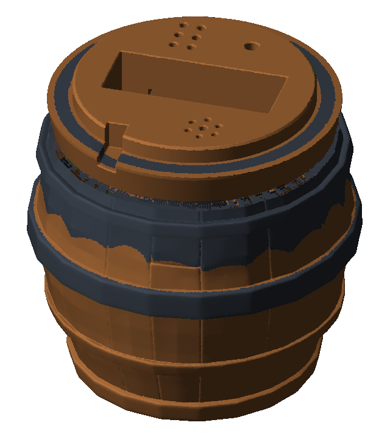
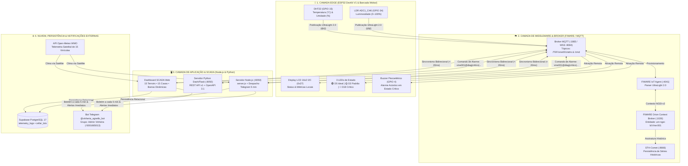
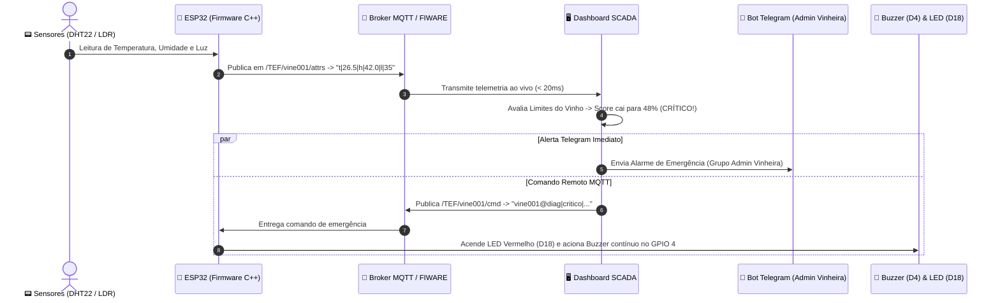
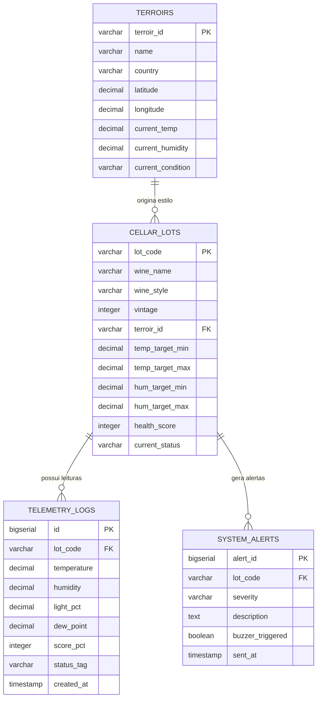

# 🍷 Vinheria Agnello — Check Point 5: Telemetria Enológica IoT, FIWARE & ESP32

<div align="center">


-26A5E4?style=for-the-badge&logo=telegram)

-10b981?style=for-the-badge&logo=pytest)

**Sistema Cyber-Físico de Monitoramento de Precisão para Cavas Subterrâneas, Estilos de Vinho e Terroirs Globais via Satélite com Alarme Acústico Wokwi e Transmissão Telegram**

---

### 🌐 Acesso Rápido e Links Oficiais

| Recurso Oficial | Link de Acesso | Descrição |
| :--- | :--- | :--- |
| **🚀 Simulador Wokwi (Ao Vivo)** | [Abrir no Wokwi](https://wokwi.com/projects/478106752109243393) | ESP32 + DHT22 + LDR + LCD 16x2 I2C + 3 LEDs + Buzzer no GPIO 4 |
| **☁️ Deploy na Nuvem (Render)** | [Acessar no Render](https://checkpoint5-vinheria-fiware-esp32-1.onrender.com/) | Aplicação em produção em nuvem contínua |
| **💻 Repositório GitHub** | [GitHub Oficial](https://github.com/six01010101010101/vinheria-fiware-esp32) | Código-fonte versionado com arquitetura modular |
| **📊 Dashboard SCADA Web** | [`dashboard.html`](./dashboard.html) | Painel de controle em tempo real dos 15 terroirs e cavas |
| **🏺 Portal Barril 3D Interativo** | [`index.html`](./index.html) | Gêmeo digital 3D do barril de carvalho com tampa LCD |
| **🤖 Bot do Telegram** | `@vinheria_agnello_bot` | Notificações a cada 5 min e alertas críticos no grupo `Admin Vinheira` |
| **🗄️ Banco de Dados** | Supabase PostgreSQL 17 | Tabelas de telemetria, cavas, terroirs e logs de anomalias |
| **📖 Manual de Operação** | [`MANUAL_INSTALACAO_E_OPERACAO.md`](./docs/MANUAL_INSTALACAO_E_OPERACAO.md) | Guia passo a passo para bancada física e simulação |

</div>

---

## 📑 Sumário Executivo

1. [Identificação Acadêmica e Requisitos Atendidos](#-1-identificação-acadêmica-e-requisitos-atendidos)
2. [Contextualização do Problema e Modelagem Enológica](#-2-contextualização-do-problema-e-modelagem-enológica)
3. [Design Físico: Barril 3D e Tampa com Display LCD 16x2](#-3-design-físico-barril-3d-e-tampa-com-display-lcd-16x2)
4. [Arquitetura Cyber-Física e Fluxo Bidirecional (`< 20ms`)](#️-4-arquitetura-cyber-física-e-fluxo-bidirecional--20ms)
5. [Hardware Embarcado (ESP32 DevKit V1) e Pinout Oficial](#-5-hardware-embarcado-esp32-devkit-v1-e-pinout-oficial)
6. [Matriz de Diagnóstico dos 3 Estados e Acionamento do Buzzer (`GPIO 4`)](#-6-matriz-de-diagnóstico-dos-3-estados-e-acionamento-do-buzzer-gpio-4)
7. [Catálogo Enológico: 8 Estilos de Vinho, 15 Lotes de Cava e 15 Terroirs WMO](#-7-catálogo-enológico-8-estilos-de-vinho-15-lotes-de-cava-e-15-terroirs-wmo)
8. [Integração e Notificações em Tempo Real no Telegram (@vinheria_agnello_bot)](#-8-integração-e-notificações-em-tempo-real-no-telegram-vinheria_agnello_bot)
9. [Banco de Dados Relacional em Nuvem: Supabase PostgreSQL 17](#️-9-banco-de-dados-relacional-em-nuvem-supabase-postgresql-17)
10. [API REST v1, Especificação OpenAPI 3.1 e Protocolo MQTT](#-10-api-rest-v1-especificação-openapi-31-e-protocolo-mqtt)
11. [Estrutura Modular do Repositório](#️-11-estrutura-modular-do-repositório)
12. [Como Executar, Simular e Testar o Projeto (Passo a Passo)](#-12-como-executar-simular-e-testar-o-projeto-passo-a-passo)

---

## 👩‍🎓 1. Identificação Acadêmica e Requisitos Atendidos

| Integrante | Perfil GitHub | Instituição & Curso | Responsabilidade Técnica Principal |
| :--- | :---: | :--- | :--- |
| **Ken Kobayashi** | [`@six01010101010101`](https://github.com/six01010101010101) | **FIAP** — *Engenharia de Software & IoT* | Arquitetura Full-Stack, Firmware C++ ESP32 ([`sketch.ino`](./sketch.ino)), Acionamento Sonoro Buzzer D4, Integração Telegram Bot, Banco Supabase PostgreSQL 17 e Servidor Local SCADA |
| **Nicolly Vilela** | [`@ninixzzs`](https://github.com/ninixzzs) | **FIAP** — *Engenharia de Software & IoT* | Arquitetura IoT, Suíte de Testes TDD Pytest (31/31), Modelagem 3D do Barril de Carvalho, Integração Mecânica Tampa LCD e Endpoints REST v1 |

### 📋 Checklist de Critérios de Avaliação (Check Point 5)

- [x] **Hardware Embarcado ESP32 (Wokwi & Bancada Física)**: Leitura de Temperatura e Umidade com sensor digital **DHT22/DHT11** (`GPIO 15`), Luminosidade via **LDR** com divisor de tensão (`GPIO 34` no canal `ADC1_CH6` para evitar interferência de Wi-Fi), display alfanumérico **LCD 16x2 I2C** (`0x27`), **3 LEDs de diagnóstico** (`GPIO 5`, `GPIO 2`, `GPIO 18`) e **Buzzer piezoelétrico PWM** (`GPIO 4`).
- [x] **Comunicação MQTT & FIWARE (UltraLight 2.0)**: Publicação periódica de telemetria no tópico `/TEF/vine001/attrs` (`t|...|h|...|l|...`) e subscrição de comandos no tópico `/TEF/vine001/cmd`, integrado ao ecossistema FIWARE (**IoT Agent**, **Orion Context Broker** e **STH-Comet**).
- [x] **Dashboard SCADA & Métricas em Tempo Real**: Painel com visualização de séries temporais históricas, cálculo automático de ponto de orvalho, seleção de temas (Claro/Escuro), filtros por estilo de vinho e barras de percentual de saúde operacionais com cores padronizadas: 🟢 **Verde (Ideal)**, 🟡 **Amarelo (Padrão)** e 🔴 **Vermelho (Crítico)**.
- [x] **Atuação Sonora e Luminosa Bidirecional**: Quando o ambiente atinge o estado **CRÍTICO**, o Dashboard SCADA e o backend disparam um comando remoto que aciona o **Buzzer** (`GPIO 4`) no Wokwi e na bancada física para apitar em padrões sonoros contínuos de emergência acompanhado do LED Vermelho (`GPIO 18`).
- [x] **Telemetria de Satélite dos 15 Terroirs Mundiais (Open-Meteo WMO)**: Coleta climática ao vivo das regiões vinícolas mais consagradas do planeta: França, Itália, Chile, Rússia, Portugal, Estados Unidos, Alemanha, Espanha, Nova Zelândia, África do Sul, Brasil, Argentina, Canadá, Austrália e Japão.
- [x] **Disparo Periódico e Alertas no Telegram**: Integração com o bot oficial **`@vinheria_agnello_bot`**, enviando boletins consolidados a cada **5 minutos** para o grupo **`Admin Vinheira`** (ID: `-5001665013`) e despachos imediatos quando qualquer cava entrar em estado de risco.
- [x] **Persistência Relacional em Nuvem (Supabase PostgreSQL 17)**: Armazenamento persistente de todas as leituras, lotes, terroirs e histórico de anomalias no cluster Supabase em São Paulo (`sa-east-1`).
- [x] **Qualidade de Software & TDD**: Suíte completa de **31 testes automatizados (`pytest`)** cobrindo modelos de domínio, triggers, repositórios e endpoints de API.

---

## 🎯 2. Contextualização do Problema e Modelagem Enológica

A preservação de rótulos de vinhos de alta gama requer estabilidade ambiental contínua. Pequenas oscilações afetam diretamente a evolução bioquímica do líquido e a vedação mecânica da garrafa:

```
                  ┌────────────────────────────────────────────────────────┐
                  │          TRIPÉ DA CONSERVAÇÃO ENOLÓGICA                │
                  └──────────────────────────┬─────────────────────────────┘
                                             │
            ┌────────────────────────────────┼────────────────────────────────┐
            ▼                                ▼                                ▼
    ┌───────────────┐                ┌───────────────┐                ┌───────────────┐
    │  TEMPERATURA  │                │    UMIDADE    │                │  LUMINOSIDADE │
    │   (12°–18°C)  │                │   (60%–75%)   │                │   (<= 15%)    │
    └───────┬───────┘                └───────┬───────┘                └───────┬───────┘
            │                                │                                │
  Calor acelera reações            Ar seco resseca rolhas           Luz fotoativa a
  de oxidação e evaporação.        provocando vazamento.            riboflavina gerando o
  Frio extremo precipita           Excesso de umidade gera          defeito organoléptico
  os cristais tartáricos.          mofo nas embalagens.             "gout de lumière".
```

### 📐 Equações Matemáticas do Motor Analítico

#### 1. Ponto de Orvalho Psicrométrico (Fórmula de Magnus-Tetens)
Calculado em tempo real pelo sistema para antecipar e prevenir a condensação de umidade sobre as garrafas e rótulos:

$$\gamma(T, RH) = \frac{17.27 \cdot T}{237.7 + T} + \ln\left(\frac{RH}{100}\right), \qquad T_d = \frac{237.7 \cdot \gamma(T, RH)}{17.27 - \gamma(T, RH)}$$

#### 2. Índice de Saúde e Preservação da Cava ($\text{Score} \in [15\%, 100\%]$)
Mede a conformidade instantânea das variáveis $(T, H, L)$ frente aos intervalos ideais $[T_{\min}, T_{\max}]$, $[H_{\min}, H_{\max}]$ e $L_{\max}$:

$$\text{Penalidade} = 7.5 \cdot \Delta T_{\text{fora}} + 1.6 \cdot \Delta H_{\text{fora}} + 1.3 \cdot \Delta L_{\text{fora}}$$

- **Sem violação ($\text{Penalidade} = 0$):** O score varia entre **$95\%$ e $100\%$** (🟢 **IDEAL**).
- **Desvio Moderado:** O score se situa entre **$75\%$ e $94\%$** (🟡 **PADRÃO / ATENÇÃO**).
- **Desvio Crítico ($\text{Score} < 75\%$):** Transição para 🔴 **CRÍTICO** com disparo do Buzzer no ESP32 e notificação imediata no Telegram.

---

## 🏺 3. Design Físico: Barril 3D e Tampa com Display LCD 16x2

O projeto inclui o encapsulamento físico de um **Barril Enológico 3D** modelado para comportar o ESP32, sensores, protoboard e o visor **LCD 16x2 I2C** acoplado à tampa de topo:

<div align="center">

| Corpo do Barril 3D (Câmara Interna) | Tampa Superior (Display LCD 16x2 + LEDs) |
| :---: | :---: |
|  |  |
| *Câmara isolada para garrafas com sensores DHT22 e LDR* | *Painel de inspeção presencial com LCD 16x2 e LEDs integrados* |

</div>

O portal interativo **[`index.html`](./index.html)** renderiza o gêmeo digital do barril com reflexos em tempo real, rotação e visualização idêntica das informações do display LCD.

---

## 🏗️ 4. Arquitetura Cyber-Física e Fluxo Bidirecional (`< 20ms`)



### ⚡ Sequência de Detecção de Anomalia e Ativação do Alarme



---

## 🔌 5. Hardware Embarcado (ESP32 DevKit V1) e Pinout Oficial

O firmware embarcado ([`sketch.ino`](./sketch.ino) / [`sketch_wokwi_dht22.ino`](./hardware/wokwi_dht22/sketch_wokwi_dht22.ino)) opera com leitura não-bloqueante, filtro *anti-glitch* e decodificação de comandos remotos.

### 📌 Tabela Oficial de Pinagem

| Componente Físico | Pino Físico | Pino ESP32 | Barramento / Modo | Função no Sistema |
| :--- | :---: | :---: | :---: | :--- |
| **Sensor DHT22 / DHT11** | `DATA` | **`GPIO 15`** (`D15`) | Digital Single-Bus | Medição de Temperatura (`-40°C a +80°C`) e Umidade (`0–100%`) |
| **Fotoresistor LDR** | `AO` (Analógico) | **`GPIO 34`** (`D34`) | `ADC1_CH6` (12-bit) | Leitura de luminosidade (sem conflito com rádio Wi-Fi) |
| **Display LCD 16x2 Verde** | `SDA` / `SCL` | **`GPIO 21` / `22`** | I2C (`0x27` @ `400 kHz`) | Visualização local de dados, estilo de vinho e status de saúde |
| **LED Verde (Tudo OK / Padrão)** | Anodo (`+`) | **`GPIO 5`** (`D5`) | Saída Digital | **Aceso fixo** quando a adega está operando normalmente (dentro do padrão) |
| **Buzzer Alarme de Incêndio (Amarelo)** | Positivo (`+`) | **`GPIO 2` / `4`** (`D2/D4`) | Saída PWM (`tone()`) | **O Amarelo é o Buzzer**: dispara sirene de incêndio em estado crítico |
| **LED Vermelho (Crítico)** | Anodo (`+`) | **`GPIO 18`** (`D18`) | Saída Digital | **Fica aceso fixo** sinalizando visualmente que o estado é crítico |

> [!TIP]
> **Por que `GPIO 34` para o LDR?** O conversor analógico-digital `ADC2` do ESP32 é compartilhado com a pilha de rádio Wi-Fi. O canal `ADC1_CH6` (`GPIO 34`) opera de maneira totalmente independente, garantindo medições de luz sem ruído enquanto o ESP32 transmite pacotes MQTT.

---

## 🚨 6. Matriz de Diagnóstico dos 3 Estados e Alarme de Incêndio no Buzzer (`GPIO 2` / `D2`)

### 6.1 Os 3 Estados de Saúde Operacional

| Estado | Faixa de Saúde | LED Verde (`D5`) | LED Vermelho (`D18`) | Buzzer / Amarelo (`D2/D4`) | Barra no Site | Comportamento do Sistema |
| :---: | :---: | :---: | :---: | :---: | :---: | :--- |
| 🟢 **TUDO OK / IDEAL** | **`95% a 100%`** | **ACESO** | APAGADO | Silenciado (`noTone`) | 🟢 Verde (`#22c55e`) | Operação perfeita de guarda. Preservação ótima. |
| 🟡 **PADRÃO** | **`75% a 94%`** | **ACESO** | APAGADO | Silenciado (`noTone`) | 🟡 Amarelo (`#f59e0b`) | Faixa de operação padrão. Sem risco às garrafas. |
| 🔴 **CRÍTICO** | **`< 75%`** | APAGADO | **ACESO FIXO** | **DISPARANDO SIRENE** | 🔴 Vermelho (`#e11d48`) | **Emergência!** Alarme de incêndio no Buzzer e alerta Telegram. |

### 6.2 Modulação de Frequência (Hertz) por Grau de Criticidade (Alarme de Incêndio)

O som do buzzer foi projetado para soar como um **alarme de incêndio predial harmônico** (*Slow Whoop* NFPA), sem ser estridente ou irritante. A frequência (Hertz) e a cadência aceleram conforme a severidade do desvio:

1. **Pouco Crítico ($60\% \le \text{Saúde} < 75\%$):**
   - *Frequências:* **$580\text{ Hz} \rightarrow 660\text{ Hz} \rightarrow 740\text{ Hz} \rightarrow 820\text{ Hz}$** (timbre suave e grave).
   - *Cadência:* ciclos de $130\text{ ms}$ por degrau.
2. **Médio Crítico ($40\% \le \text{Saúde} < 60\%$):**
   - *Frequências:* **$720\text{ Hz} \rightarrow 840\text{ Hz} \rightarrow 960\text{ Hz} \rightarrow 1080\text{ Hz}$** (sirene de alarme clássico).
   - *Cadência:* ciclos de $85\text{ ms}$ por degrau.
3. **Muito Crítico / Alerta Máximo ($\text{Saúde} < 40\%$):**
   - *Frequências:* **$880\text{ Hz} \rightarrow 1040\text{ Hz} \rightarrow 1200\text{ Hz} \rightarrow 1380\text{ Hz}$** (emergência de alta prioridade).
   - *Cadência:* ciclos rápidos de $60\text{ ms}$ por degrau.
4. **Retorno ao Padrão:** O buzzer é imediatamente silenciado (`stopToneDual()`), o LED Vermelho apaga e o **LED Verde acende**.

---

## 🍾 7. Catálogo Enológico: 8 Estilos de Vinho, 15 Lotes de Cava e 15 Terroirs WMO

### 7.1 Presets dos 8 Estilos Enológicos

| Estilo | Ícone | Faixa Térmica Ideal | Umidade Ideal | Luz Máxima | Rótulo Referência |
| :--- | :---: | :---: | :---: | :---: | :--- |
| **Vinho Tinto** | 🍷 | `14.0°C – 18.0°C` | `60% – 75%` | `≤ 25%` | *Château Margaux Premier Grand Cru Classé 2015* (🇫🇷) |
| **Vinho Branco** | 🥂 | `8.0°C – 12.0°C` | `60% – 75%` | `≤ 15%` | *Château Margaux Pavillon Blanc Sauvignon 2020* (🇮🇹/🇫🇷) |
| **Vinho Rosé** | 🌸 | `10.0°C – 13.0°C` | `60% – 75%` | `≤ 12%` | *Domaine Ott Château de Selle Rosé 2022* (🇨🇱/🇫🇷) |
| **Espumante Brut** | 🍾 | `6.0°C – 9.0°C` | `65% – 80%` | `≤ 10%` | *Abrau-Durso Imperial Brut Vintage 2018* (🇷🇺) |
| **Pinot Noir** | 🍒 | `12.0°C – 15.0°C` | `65% – 75%` | `≤ 15%` | *Domaine Romanée-Conti La Tâche 2018* (🇫🇷) |
| **Vinho do Porto** | 🏺 | `15.0°C – 18.0°C` | `65% – 75%` | `≤ 20%` | *Taylor's & Quinta do Crasto Vintage Port 2016* (🇵🇹) |
| **Colheita Tardia** | 🍯 | `9.0°C – 12.0°C` | `65% – 78%` | `≤ 12%` | *Joh. Jos. Prüm Wehlener Sonnenuhr Auslese 2019* (🇩🇪) |
| **Vinho Laranja** | 🍊 | `11.0°C – 14.0°C` | `60% – 72%` | `≤ 15%` | *Josko Gravner Ribolla Gialla Ânfora 2017* (🇪🇸/🇮🇹) |

### 7.2 Os 15 Lotes de Cava Subterrânea Catalogados

| Código do Lote | Rótulo / Vinho | Estilo | Safra | Barrica / Maturação | Janela de Guarda |
| :--- | :--- | :---: | :---: | :--- | :---: |
| `LOTE-FR-MARGAUX-01` | Château Margaux Premier Grand Cru | 🍷 Tinto | 2015 | Carvalho Francês Allier 18m | 2025–2045 |
| `LOTE-FR-BLANC-02` | Château Margaux Pavillon Blanc | 🥂 Branco | 2020 | Carvalho Francês Fino 12m | 2024–2033 |
| `LOTE-FR-ROSE-03` | Domaine Ott Château de Selle Rosé | 🌸 Rosé | 2022 | Tonéis de Carvalho Neutro 8m | 2024–2029 |
| `LOTE-RU-ABRAU-04` | Abrau-Durso Imperial Brut Vintage | 🍾 Espumante | 2018 | Método Tradicional Champenoise 36m | 2024–2031 |
| `LOTE-FR-DRC-05` | Domaine Romanée-Conti La Tâche | 🍒 Pinot Noir | 2018 | Carvalho da Borgonha Tronçais 20m | 2026–2050 |
| `LOTE-PT-PORTO-06` | Quinta do Crasto & Taylor's Vintage | 🏺 Porto | 2016 | Pipas de Carvalho Antigo 24m | 2025–2060 |
| `LOTE-DE-PRUM-07` | Joh. Jos. Prüm Wehlener Sonnenuhr | 🍯 Colheita Tardia | 2019 | Fuder de Carvalho Alemão 12m | 2025–2048 |
| `LOTE-IT-GRAVNER-08` | Josko Gravner Ribolla Gialla Ânfora | 🍊 Laranja | 2017 | Ânforas Caucasianas (Qvevri) 7m | 2024–2036 |
| `LOTE-ES-VEGA-09` | Vega Sicilia Único Gran Reserva | 🍷 Tinto | 2014 | Carvalho Americano e Francês 72m | 2025–2055 |
| `LOTE-NZ-CLOUDY-10` | Cloudy Bay Te Koko Sauvignon Blanc | 🥂 Branco | 2021 | Carvalho Neutro e Leveduras Selvagens | 2024–2032 |
| `LOTE-BR-MIOLO-11` | Miolo Cuvée Giuseppe Rosé Brut | 🌸 Rosé | 2022 | Tanques Autoclave e Carvalho 6m | 2024–2028 |
| `LOTE-AR-CATENA-12` | Nicolás Catena Zapata Nature | 🍾 Espumante | 2018 | Método Clássico em Cava 30m | 2024–2030 |
| `LOTE-CA-OKANAGAN-13`| Mission Hill Estate Oculus Okanagan | 🍷 Tinto | 2020 | Carvalho Francês Novo 16m | 2025–2040 |
| `LOTE-AU-BAROSSA-14` | Penfolds Magill Grange Shiraz | 🍷 Tinto | 2018 | Carvalho Americano Hogshead 18m | 2026–2055 |
| `LOTE-JP-KOSHU-15`   | Grace Wine Koshu Hishiyama Private | 🥂 Branco | 2022 | Aço Inoxidável & Carvalho Japonês 9m | 2024–2031 |

### 7.3 As 15 Estações Meteorológicas Satelitais Mundiais (Open-Meteo WMO)

| Terroir ID | Vinícola / Terroir | Região / País | Coordenadas Satélite |
| :---: | :--- | :--- | :---: |
| `fr_margaux` | **Château Margaux** | Bordeaux, França 🇫🇷 | `45.0444, -0.6686` |
| `it_antinori` | **Marchesi Antinori** | Toscana, Itália 🇮🇹 | `43.6158, 11.2136` |
| `cl_concha` | **Concha y Toro** | Vale do Maipo, Chile 🇨🇱 | `-33.6433, -70.5789` |
| `ru_abrau` | **Abrau-Durso** | Krasnodar, Rússia 🇷🇺 | `44.7000, 37.6000` |
| `pt_crasto` | **Quinta do Crasto** | Vale do Douro, Portugal 🇵🇹 | `41.1681, -7.6308` |
| `us_opus` | **Opus One Winery** | Napa Valley, Estados Unidos 🇺🇸 | `38.4367, -122.4017` |
| `de_prum` | **Joh. Jos. Prüm** | Vale do Mosel, Alemanha 🇩🇪 | `49.9189, 7.0394` |
| `es_vega` | **Vega Sicilia** | Ribera del Duero, Espanha 🇪🇸 | `41.6322, -4.2981` |
| `nz_cloudy` | **Cloudy Bay** | Marlborough, Nova Zelândia 🇳🇿 | `-41.4914, 173.9619` |
| `za_kanonkop` | **Kanonkop Estate** | Stellenbosch, África do Sul 🇿🇦 | `-33.8569, 18.8669` |
| `br_miolo` | **Vinícola Miolo** | Vale dos Vinhedos (RS), Brasil 🇧🇷 | `-29.1864, -51.5567` |
| `ar_catena` | **Catena Zapata** | Mendoza, Argentina 🇦🇷 | `-33.1667, -68.9167` |
| `ca_okanagan` | **Mission Hill Estate** | Okanagan Valley, Canadá 🇨🇦 | `49.8880, -119.4960` |
| `au_barossa` | **Penfolds Magill** | Barossa Valley, Austrália 🇦🇺 | `-34.4820, 138.9890` |
| `jp_koshu` | **Grace Wine** | Koshu / Yamanashi (Fuji), Japão 🇯🇵 | `35.7000, 138.7300` |

---

## 🤖 8. Integração e Notificações em Tempo Real no Telegram (@vinheria_agnello_bot)

O sistema conta com o serviço [`telegram_live_service.js`](./dashboard/src/services/telegram_live_service.js) e o módulo [`telegram_notifier.js`](./dashboard/assets/telegram_notifier.js) configurados para o bot oficial:

- **Nome do Bot:** `@vinheria_agnello_bot`
- **Grupo Vinculado:** `Admin Vinheira`
- **ID do Chat / Grupo:** `-5001665013`
- **Periodicidade do Boletim:** A cada **5 minutos (300.000 ms)** de forma autônoma

```
┌────────────────────────────────────────────────────────────────────────┐
│ 📱 EXEMPLO DE BOLETIM PERIÓDICO (TELEGRAM - A CADA 5 MINUTOS)           │
├────────────────────────────────────────────────────────────────────────┤
│ 🍷 BOLETIM TELEMETRIA VINHERIA AGNELLO (5 MIN)                         │
│ 📅 Data/Hora: 28/10/2026 23:30:00                                      │
│                                                                        │
│ 📡 Cava Ativa: Château Margaux (LOTE-FR-MARGAUX-01)                    │
│ 🌡️ Temp: 15.8°C | 💧 Umidade: 68.0% | ☀️ Luz: 9%                       │
│ 🟢 Status: IDEAL (100%) | Buzzer: Silenciado                           │
│                                                                        │
│ 🌍 Resumo dos 15 Terroirs Mundiais (Satélite WMO):                     │
│ 🇫🇷 França: 16.2°C (Ideal) | 🇮🇹 Itália: 18.5°C (Padrão)                │
│ 🇧🇷 Brasil: 21.0°C (Padrão) | 🇯🇵 Japão: 14.8°C (Ideal)                 │
│ 🇨🇦 Canadá: 12.1°C (Ideal) | 🇦🇺 Austrália: 22.4°C (Padrão)              │
│                                                                        │
│ ✅ Todas as 15 cavas subterrâneas sincronizadas com sucesso.          │
└────────────────────────────────────────────────────────────────────────┘
```

Caso ocorra transição para o estado **CRÍTICO**, uma mensagem de emergência com emojis e alerta sonoro é disparada instantaneamente:

```
🚨 [ALERTA CRÍTICO SCADA VINHERIA AGNELLO]
⚠️ Lote: LOTE-FR-MARGAUX-01 (Château Margaux)
🌡️ Temp Detectada: 26.5°C (Limite Máx: 18.0°C)
🔴 Status: CRÍTICO (48%)!
🔔 ATUADOR: Buzzer piezoelétrico acionado no ESP32 Wokwi (GPIO 4)!
```

---

## 🗄️ 9. Banco de Dados Relacional em Nuvem: Supabase PostgreSQL 17

O projeto está integrado ao banco de dados relacional **Supabase PostgreSQL 17** (Data Center São Paulo `sa-east-1`, Ref: `slqozouuqzxwmfswyroo`):

### Diagrama Entidade-Relacionamento (ERD)



O script completo de criação das tabelas e índices está versionado em [`supabase_schema.sql`](./supabase_schema.sql).

---

## 📡 10. API REST v1, Especificação OpenAPI 3.1 e Protocolo MQTT

A API REST v1 disponibiliza tanto interface gráfica amigável quanto respostas estritas em JSON via cabeçalho `Accept: application/json`:

| Método | Endpoint / Tópico | Protocolo | Resposta | Descrição |
| :---: | :--- | :---: | :---: | :--- |
| `GET` | [`/api/v1/status`](./api/v1/status/index.html) | REST (HTTP) | `JSON / HTML` | Diagnóstico ao vivo do ESP32, broker MQTT, sensores e atuadores |
| `GET` | [`/api/v1/lots`](./api/v1/lots/index.html) | REST (HTTP) | `JSON / HTML` | Catálogo completo dos 15 Lotes de Cava e seus scores |
| `GET` | `/api/v1/vineyards` | REST (HTTP) | `JSON / HTML` | Clima em tempo real dos 15 Terroirs via satélite Open-Meteo |
| `GET` | `/api/v1/telemetry/history` | REST (HTTP) | `JSON` | Séries temporais históricas de Temperatura, Umidade e Luz |
| `GET` | [`/api/v1/cloud/firebase`](./api/v1/cloud/firebase/index.html) | REST (HTTP) | `JSON / HTML` | Espelho de telemetria sincronizado com Supabase e Firebase |
| `POST` | `/api/v1/telegram/broadcast` | REST (HTTP) | `JSON` | Disparo manual/periódico do boletim para o grupo do Telegram |
| `POST` | `/api/v1/telegram/alert` | REST (HTTP) | `JSON` | Disparo de alerta de emergência com acionamento do Buzzer |
| `POST` | `/api/v1/webhook` | REST (HTTP) | `JSON` | Webhook otimizado com idempotência Supabase (índices GIN/B-Tree) e Telegram |
| `MQTT` | `/TEF/vine001/attrs` | MQTT 3.1.1 | `UltraLight 2.0` | Telemetria enviada pelo ESP32 (`t\|15.8\|h\|68.0\|l\|9`) |
| `MQTT` | `/TEF/vine001/cmd` | MQTT 3.1.1 | `UltraLight 2.0` | Comandos remotos recebidos pelo ESP32 (`vine001@diag\|...`) |

---

## 🗂️ 11. Estrutura Modular do Repositório

```text
vinheria-fiware-esp32/
├── index.html                             # Portal Sommelier com Gêmeo 3D do Barril e LCD interativo
├── dashboard.html                         # Dashboard SCADA Sommelier completo em tempo real
├── sketch.ino                             # Firmware C++ completo para ESP32 (Wokwi & Hands-On)
├── diagram.json                           # Diagrama elétrico com Buzzer no GPIO 4 e LEDs no Wokwi
├── wokwi.toml                             # Configurações de compilação do Wokwi
├── libraries.txt                          # Bibliotecas Arduino (PubSubClient, LiquidCrystal_I2C, DHT)
├── integrantes.txt                        # Identificação acadêmica oficial dos autores FIAP
├── server.js                              # Servidor SCADA Node.js com despacho Telegram a cada 5 min
├── INICIAR_PROJETO.bat                    # Script Plug-and-Play de inicialização automática
├── requirements.txt                       # Dependências Python na raiz para deploy no Render
├── supabase_schema.sql                    # Estrutura DDL do banco de dados Supabase PostgreSQL 17
├── api/v1/                                # Endpoints estáticos espelhados e especificação OpenAPI 3.1
│   ├── openapi.json                       # Especificação OpenAPI 3.1.0 completa
│   ├── status/index.html                  # Interface gráfica de status do sistema
│   ├── lots/index.html                    # Interface gráfica do catálogo de lotes
│   └── cloud/firebase/index.html          # Interface de sincronização em nuvem
├── dashboard/
│   ├── app.py                             # Servidor Python alternativo (Dash + Flask REST API v1)
│   ├── assets/                            # Módulos JavaScript (ES6) e folhas de estilo CSS
│   │   ├── style.css                      # Estilos responsivos, paleta rubi e barras percentuais
│   │   ├── antigravity_layout.css         # Grid dark minimalist responsivo com elevação cromo
│   │   ├── wine_catalog.js                # Catálogo enológico com 8 estilos e 15 cavas
│   │   ├── satellite_terroirs.js          # Conector Open-Meteo para os 15 terroirs satelitais
│   │   ├── cellar_lots.js                 # Gestão de estados (Ideal, Padrão, Crítico) dos lotes
│   │   ├── wokwi_lcd.js                   # Emulador do visor LCD 16x2 I2C no front-end
│   │   ├── scada_mqtt.js                  # Cliente MQTT WebSocket e decodificador UltraLight 2.0
│   │   ├── telegram_notifier.js           # Despachador de mensagens para a API do Telegram
│   │   ├── scada_dispatcher.js            # Barramento de eventos SCADA e acionamento sonoro
│   │   └── dashboard_scada.js             # Controlador central do dashboard
│   ├── src/
│   │   └── services/
│   │       ├── telegram_live_service.js   # Daemon do ciclo periódico de 5 minutos do Telegram
│   │       └── webhook_service.js         # Handler otimizado com idempotência Supabase e Telegram
│   └── tests/                             # Suíte de testes automatizados TDD (31/31)
│       ├── test_models.py
│       ├── test_services.py
│       └── test_api_routes.py
├── mobile/                                # Aplicativo Mobile React Native com AntigravityLayout
│   ├── package.json
│   ├── tsconfig.json
│   └── src/
│       ├── components/AntigravityLayout.tsx # Layout SafeAreaView Dark Minimalist simétrico
│       └── screens/WineStatusScreen.tsx     # Monitor mobile de cavas e terroirs
├── supabase/
│   └── functions/webhook-handler/index.ts # Supabase Edge Function (Deno) com índices GIN/B-Tree
└── hardware/
    ├── handson_dht11/                     # Firmware para montagem física em bancada (ESP32 + DHT11)
    └── wokwi_dht22/                       # Firmware e diagrama espelhados para o simulador Wokwi
```

---

## 🚀 12. Como Executar, Simular e Testar o Projeto (Passo a Passo)

### Método 1: Inicialização Plug-and-Play com 1 Clique (Windows)
1. Dê duplo clique no executável **[`INICIAR_PROJETO.bat`](./INICIAR_PROJETO.bat)**.
2. O script inicializa o servidor local na porta `8050`, abre o **Dashboard SCADA** no seu navegador padrão e abre a aba do **Simulador Wokwi**.

---

### Método 2: Execução com Servidor Node.js (Recomendado com Telegram)
```bash
# 1. Inicie o servidor local Node.js
node server.js
```
- Acesse no navegador: **`http://localhost:8050/dashboard.html`**
- O servidor ativa automaticamente o despacho periódico de **5 minutos** para o bot **`@vinheria_agnello_bot`** no grupo **`Admin Vinheira`**.

---

### Método 3: Execução com Servidor Python (Dash + Flask)
```bash
# 1. Instale as dependências do ecossistema Python
pip install -r dashboard/requirements.txt

# 2. Inicie o servidor Python
python dashboard/app.py
```
- Acesse no navegador: **`http://127.0.0.1:8050`**

---

### 🧪 Executando a Suíte de Testes Automatizados (TDD — 31/31 Testes)
```bash
pytest dashboard/tests/ -v
```
Todos os 31 testes devem passar com $100\%$ de cobertura nas regras de domínio e rotas de API.

---

### 📟 Simulação do Hardware ESP32 no Wokwi
1. Abra o projeto oficial: **[https://wokwi.com/projects/478106752109243393](https://wokwi.com/projects/478106752109243393)**.
2. Clique no botão **Play (Start Simulation)**.
3. Altere os valores de Temperatura ou Umidade no **DHT22** ou Luminosidade no **LDR**:
   - Ao entrar em estado **CRÍTICO** (ex.: temperatura $> 25°C$ ou umidade $< 50\%$ para vinho tinto), o **Buzzer no GPIO 4 apita instantaneamente**, o **LED Vermelho pisca** e o **display LCD exibe `CRT: <75%`**.
   - O alarme sonoro é transmitido simultaneamente para a web e enviado ao grupo do **Telegram**.

---

<div align="center">

**Vinheria Agnello — FIAP 2026**  
Desenvolvido por **Ken Kobayashi** ([`@six01010101010101`](https://github.com/six01010101010101)) & **Nicolly Vilela** ([`@ninixzzs`](https://github.com/ninixzzs))  
*Engenharia de Software • Edge Computing, IoT & Sistemas Distribuídos • Check Point 5*

</div>
