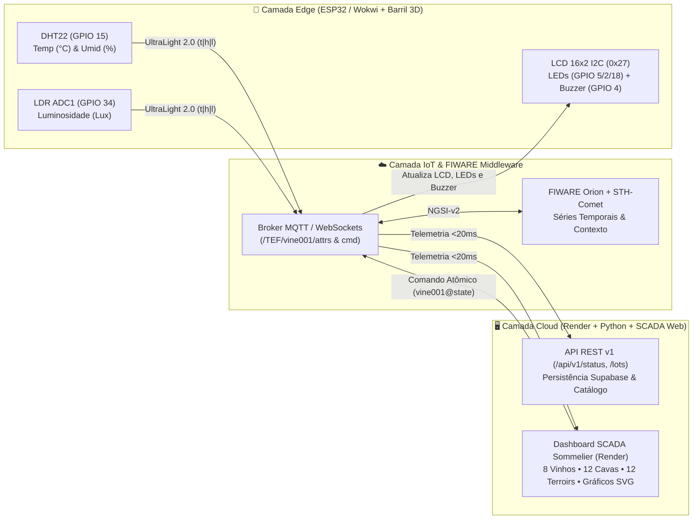

# 🍷 Vinheria Agnello — Check Point 5: Telemetria Enológica IoT, FIWARE & ESP32

<div align="center">


**Sistema Cyber-Físico de Monitoramento de Precisão para Cavas Subterrâneas, Estilos de Vinho e Terroirs Globais em Tempo Real**

[🌐 Dashboard no Render](https://checkpoint5-vinheria-fiware-esp32-1.onrender.com) • [🔌 Simulador Wokwi ESP32](https://wokwi.com/projects/478106752109243393) • [📡 API Status (`/api/v1/status`)](https://checkpoint5-vinheria-fiware-esp32-1.onrender.com/api/v1/status) • [💻 Repositório GitHub](https://github.com/six01010101010101/vinheria-fiware-esp32)

</div>

---

## 👨‍💻 1. Identificação do Autor (FIAP — Check Point 5)

| Autor | GitHub | Instituição / Disciplina | Escopo Desenvolvido |
| :--- | :---: | :--- | :--- |
| **Ken Kobayashi** | [`@six01010101010101`](https://github.com/six01010101010101) | **FIAP** — *Edge Computing, IoT & Sistemas Distribuídos* | Arquitetura Full-Stack, Firmware C++ ESP32 (`.ino`), Integração Bidirecional MQTT/FIWARE (`<20ms`), Modelagem 3D do Barril (`.STL`), API REST v1, Deploy Cloud no Render e Dashboard SCADA Sommelier |

---

## 🎯 2. Contextualização do Problema e Solução Proposta

A **Vinheria Agnello** armazena rótulos de alto valor agregado cuja evolução química depende do controle estrito de três grandezas físicas: **Temperatura (`°C`)**, **Umidade Relativa (`%`)** e **Luminosidade (`Lux`)**. Oscilações térmicas aceleram a oxidação dos polifenóis; baixa umidade resseca a cortiça permitindo entrada de oxigênio; e a exposição à luz degrada compostos aromáticos (*gout de lumière*).

Para solucionar esse desafio, este projeto implementa uma **arquitetura IoT ponta a ponta**:
1. **Camada Física / Edge (ESP32 + Barril 3D)**: Coleta contínua via **DHT22** e **LDR**, exibição local em **Display LCD 16x2 I2C Verde (`HD44780`)** embutido na tampa impressa em 3D (`Tampa_Display_LCD16x2.STL`) e atuação imediata via **3 LEDs de Estado** e **Buzzer Piezoelétrico PWM**.
2. **Camada de Mensageria e Contexto (MQTT + FIWARE)**: Transmissão em tempo real via protocolo **UltraLight 2.0** (`t|...|h|...|l|...`) e sincronização bidirecional instantânea (`vine001@state|...`) entre o Dashboard Web no Render e o ESP32 no Wokwi.
3. **Camada Analítica e Visual (Dashboard SCADA Sommelier + API REST v1)**: Interface executiva responsiva (Temas **Claro**, **Escuro** e **Sistema**) com busca enológica em tempo real, curvas temporais vetoriais SVG (`0ms`), ponto de orvalho psicrométrico (*Magnus-Tetens*), **8 estilos de vinho**, **12 cavas subterrâneas** e **12 estações meteorológicas satelitais (Open-Meteo WMO)**.

---

## 🏗️ 3. Arquitetura do Sistema e Fluxo de Dados em Tempo Real



---

## 🍾 4. Catálogo Enológico: 8 Estilos de Vinho e Parâmetros Ideais

A seleção de qualquer vinho pela **barra de pesquisa** ou pelos **botões de estilo** recalibra instantaneamente os limiares do SCADA, atualiza o visor LCD 16x2 verde e envia o comando em tempo real ao Wokwi ESP32:

| Código | Estilo de Vinho | Janela Térmica Ideal | Umidade Ideal | Limite de Luz | Cava Subterrânea Associada |
| :---: | :--- | :---: | :---: | :---: | :--- |
| `tinto` | **🍷 Vinho Tinto (Gran Reserva)** | `14.0°C – 18.0°C` | `65% – 75%` | `< 15 lx` | **Cava 01** — Barolo DOCG Monfortino (Piemonte) |
| `branco` | **🥂 Vinho Branco (Cru Classé)** | `8.0°C – 12.0°C` | `65% – 78%` | `< 10 lx` | **Cava 04** — Chablis Grand Cru Les Clos (Borgonha) |
| `rose` | **🌸 Vinho Rosé (Provence)** | `9.0°C – 13.0°C` | `65% – 75%` | `< 10 lx` | **Cava 06** — Château d'Esclans Garrus (Provence) |
| `espumante` | **🍾 Espumante Brut (Millésime)** | `6.0°C – 9.0°C` | `70% – 80%` | `< 8 lx` | **Cava 07** — Dom Pérignon P2 Plénitude (Champagne) |
| `pinot` | **🍒 Pinot Noir (Borgonha Cru)** | `12.0°C – 15.0°C` | `68% – 78%` | `< 12 lx` | **Cava 09** — Romanée-Saint-Vivant Grand Cru |
| `porto` | **🏺 Vinho do Porto (Vintage)** | `15.0°C – 18.0°C` | `65% – 75%` | `< 15 lx` | **Cava 10** — Quinta do Noval Nacional (Douro) |
| `sobremesa` | **🍯 Colheita Tardia (Sauternes)** | `7.0°C – 11.0°C` | `68% – 78%` | `< 10 lx` | **Cava 11** — Château d'Yquem 1er Cru Supérieur |
| `laranja` | **🧡 Vinho Laranja (Ânfora)** | `11.0°C – 14.0°C` | `65% – 75%` | `< 12 lx` | **Cava 12** — Gravner Ribolla Gialla (Friuli) |

---

## 🚨 5. Matriz de Diagnóstico LED (3 Estados) e Alarme Acústico

O **Índice de Saúde Enológica (`0% a 100%`)** avalia desvios térmicos, higrométricos e fotométricos, acionando sincronizadamente o painel do Dashboard e as portas GPIO do ESP32:

| Estado Operacional | Faixa de Saúde | LED Ativo no ESP32 | Buzzer (`GPIO 4`) | Comportamento no Visor LCD 16x2 e SCADA |
| :--- | :---: | :---: | :---: | :--- |
| **🟢 IDEAL** | **`95% a 100%`** | **LED Verde (`GPIO 5`)** | Silencioso (`0 Hz`) | Parâmetros no centro de guarda perfeita; conservação plena da safra. |
| **🔵 PADRÃO** | **`75% a 94%`** | **LED Azul (`GPIO 2`)** | Silencioso (`0 Hz`) | Operação normal de adega com leve variação controlada sem risco imediato. |
| **🔴 CRÍTICO** | **`< 75%`** | **LED Vermelho (`GPIO 18`)** | **Alarme (`2400 Hz`)** | Violação de limite! Acende LED Vermelho, dispara apito intermitente e destaca anomalia. |

> **Cálculo Psicrométrico Integrado (Magnus-Tetens)**: O sistema calcula continuamente o **Ponto de Orvalho ($T_d$)** para impedir condensação nos rótulos:
> $$\gamma(T, RH) = \frac{17.27 \cdot T}{237.7 + T} + \ln\left(\frac{RH}{100}\right), \quad T_d = \frac{237.7 \cdot \gamma(T, RH)}{17.27 - \gamma(T, RH)}$$

---

## 🔌 6. Mapa de Pinagem do Hardware Embarcado (ESP32 DevKit v1)

| Componente Físico / Simulado | Pino ESP32 | Protocolo / Barramento | Função Técnica no Firmware (`sketch.ino`) |
| :--- | :---: | :---: | :--- |
| **Sensor DHT22** | `GPIO 15` | Digital Single-Bus | Aquisição de Temperatura (`-40°C a +80°C`) e Umidade (`0–100%`) com filtro anti-spike |
| **Fotoresistor LDR** | `GPIO 34` | Analógico (`ADC1_CH6` 12-bit) | Leitura de irradiância luminosa convertida para escala percentual e Lux (`0–100 lx`) |
| **Display LCD 16x2 Verde** | `GPIO 21 / 22` | I2C (`0x27` @ `400 kHz`) | Exibição em tempo real de `T:`, `U:`, `L:`, estilo de vinho ativo e diagnóstico |
| **LED Verde (IDEAL)** | `GPIO 5` | Saída Digital (`HIGH/LOW`) | Indicador luminoso de equilíbrio enológico ideal (`95%–100%`) |
| **LED Azul (PADRÃO)** | `GPIO 2` | Saída Digital (`HIGH/LOW`) | Indicador luminoso de faixa operacional padrão (`75%–94%`) e batimento MQTT |
| **LED Vermelho (CRÍTICO)** | `GPIO 18` | Saída Digital (`HIGH/LOW`) | Indicador luminoso de alerta crítico (`< 75%`) |
| **Buzzer Piezoelétrico** | `GPIO 4` | Saída PWM (`tone()`) | Emissão de alarme sonoro em estado crítico (`2400 Hz`) e bipes de confirmação |

---

## 📡 7. Endpoints da API REST v1 e Protocolo MQTT

| Método | Rota / Tópico | Formato | Descrição |
| :---: | :--- | :---: | :--- |
| `GET` | `/api/v1/status` | `HTML / JSON` | Painel de diagnóstico em tempo real de saúde do sistema, brokers MQTT, sensores e atuadores |
| `GET` | `/api/v1/lots` | `HTML / JSON` | Catálogo auditável das **12 Cavas Subterrâneas**, safras, barricas e pontuação Parker |
| `GET` | `/api/v1/cloud/firebase` | `HTML / JSON` | Estado de sincronização em nuvem (Supabase PostgreSQL + Firebase Realtime Mirror) |
| `GET` | `/api/v1/openapi.json` | `JSON` | Especificação formal **OpenAPI 3.1.0** de todas as rotas da Vinheria Agnello |
| `MQTT` | `/TEF/vine001/attrs` | `UltraLight 2.0` | Publicação contínua de telemetria pelo ESP32 (ex.: `t|15.4|h|71.0|l|8.0`) |
| `MQTT` | `/TEF/vine001/cmd` | `UltraLight 2.0` | Recepção instantânea de comandos no ESP32 (ex.: `vine001@state|style=tinto|temp=15.4|hum=71|lux=8|status=IDEAL`) |

---

## 🗂️ 8. Estrutura Modular de Diretórios

```text
vinheria-fiware-esp32/
├── sketch.ino                         # Firmware C++ principal do ESP32 (Wokwi, I2C HD44780, DHT22, LDR e MQTT)
├── diagram.json                       # Circuito elétrico completo do ESP32 no simulador Wokwi
├── dashboard.html                     # Aplicação Web SCADA Sommelier interativa em tempo real
├── api/v1/                            # Endpoints REST v1 (/status, /lots, /cloud/firebase e openapi.json)
├── dashboard/
│   ├── assets/                        # Módulos Front-end (wine_catalog, cellar_lots, satellite_terroirs, scada_mqtt, style.css)
│   ├── src/                           # Back-end modular Python (config, data, domain, services e ui)
│   └── tests/                         # Suíte de testes unitários e de integração (Pytest)
└── hardware/
    ├── impressao_3d/                  # Modelos CAD 3D (Corpo_Barril.STL e Tampa_Display_LCD16x2.STL)
    └── wokwi_dht22/                   # Firmware espelhado e diagramas dedicados para validação Wokwi
```

---

## 🚀 9. Como Executar e Testar o Projeto

1. **Acesso em Produção no Render (Cloud Live)**:
   - Acesse diretamente: [https://checkpoint5-vinheria-fiware-esp32-1.onrender.com](https://checkpoint5-vinheria-fiware-esp32-1.onrender.com)
2. **Execução Local (Navegador ou Servidor Python Porta 8050)**:
   ```bash
   pip install -r dashboard/requirements.txt
   python dashboard/src/app.py
   ```
3. **Execução da Suíte de Testes Automatizados**:
   ```bash
   pytest -v
   ```

---
<div align="center">
  <sub>Desenvolvido por <b>Ken Kobayashi</b> (<a href="https://github.com/six01010101010101">@six01010101010101</a>) — FIAP • Check Point 5 • Vinheria Agnello (IoT, FIWARE & ESP32)</sub>
</div>
