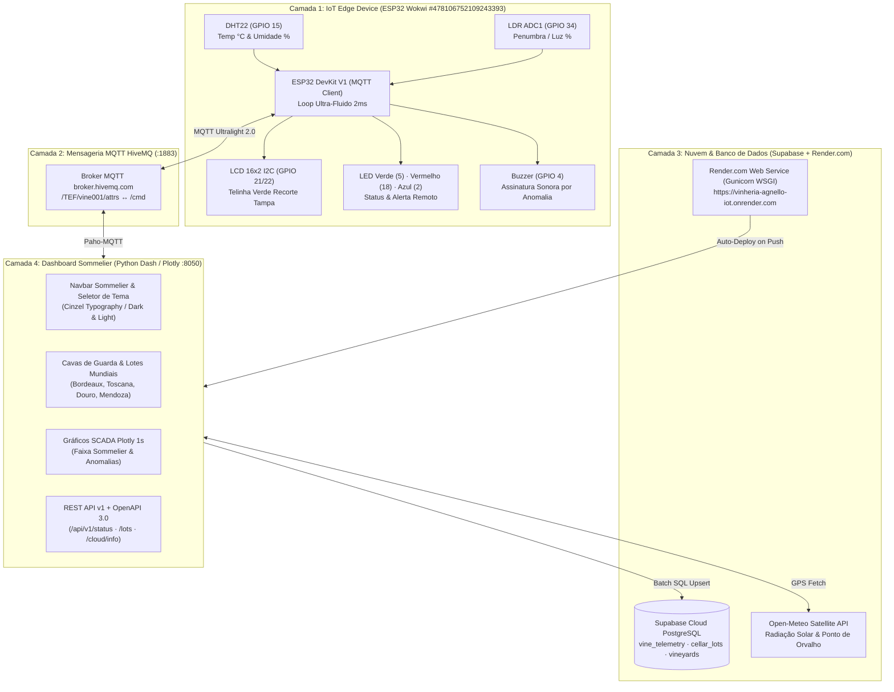

# 🍷 Vinheria Agnello · Gestão de Adega, Lotes & Terroirs IoT (Check Point 5)


-2EA44F?style=for-the-badge)


> **Plataforma Enológica IoT Ponta a Ponta**: Monitoramento em tempo real de microclima de cavas (Temperatura, Higrometria da Rolha e Penumbra), rastreamento de **8 Lotes Mundiais** de alta gama, telemetria via satélite de **9 Vinícolas Reais** (Open-Meteo), persistência em nuvem no **Supabase PostgreSQL**, integração **FIWARE** (Orion, IoT Agent, STH-Comet), simulação **Wokwi ESP32** ultra-fluida e deploy contínuo no **Render.com**.

---

## 👥 Integrantes do Grupo

| Nome Completo | RM | Responsabilidade Principal |
| :--- | :---: | :--- |
| **Gabriel Antunes** | `RM 555620` | Firmware ESP32 Wokwi (`.ino`), Sensores DHT22/LDR e Atuadores |
| **Matheus Bueno** | `RM 555026` | Arquitetura Back-end, Repositórios, REST API v1 e Supabase Cloud |
| **Vinicius** | `RM 557613` | Dashboard Front-end Sommelier, Layout Reativo e Visual Identity |
| **[Integrante 4]** | `RM XXXXX` | Integração FIWARE (Orion, IoT Agent, STH-Comet) e Documentação |

---

## 🏗️ 1. Arquitetura em Camadas (Standard 2025)



---

## 🍷 2. Front-End: Identidade Visual & Componentes Sommelier

O Front-end foi construído sob arquitetura modular estrita (cada arquivo $\le 200$ linhas) com tokens de design sommelier:
- **Tipografia Clássica Enológica**: Fonte romana serifa `Cinzel`, `Georgia`, `serif` para títulos de cavas, safras e grand cru.
- **Paleta Nobre**: *Bordeaux / Vinho Tinto* (`#722F37` / `#8b263e`) combinado a *Ouro de Guarda* (`#b38738` claro / `#d4af37` escuro).
- **Tema Duplo Responsivo (Sem Flash Branco)**:
  - **Modo Claro**: Fundo `#f8fafc`, cartões `#ffffff`, barra de pesquisa branca com bordas suaves `#cbd5e1`.
  - **Modo Escuro**: Fundo `#070b12`, cartões `#0d1420`, barras de pesquisa em tom escuro `#0c131d` (zero elementos brancos).
- **Módulos do Front-end (`dashboard/src/ui/components/`)**:
  1. [`navbar.py`](dashboard/src/ui/components/navbar.py): Marca `Vinheria Agnello · Reserva do Sommelier`, status Wokwi em tempo real e switcher Claro/Escuro/Sistema.
  2. [`header_and_triggers.py`](dashboard/src/ui/components/header_and_triggers.py): Presets Enológicos (Tinto, Branco, Rosé, Espumante, Sobremesa) e calibração de faixas térmicas e higrométricas.
  3. [`cellar_lots_panel.py`](dashboard/src/ui/components/cellar_lots_panel.py): Catálogo de 8 lotes mundiais autênticos com safras (*vintages*), datas de envase, janela de apogeu, solos e afinamento em barricas.
  4. [`charts_and_status.py`](dashboard/src/ui/components/charts_and_status.py): Curvas históricas Plotly com marcadores inteligentes, linhas de média e faixa sombreada `ZONA DO SOMMELIER`.
  5. [`real_vineyards_panel.py`](dashboard/src/ui/components/real_vineyards_panel.py): Grade de satélite Open-Meteo de 9 vinícolas mundiais com cálculo de ponto de orvalho (*Magnus-Tetens*).
  6. [`hardware_plaque.py`](dashboard/src/ui/components/hardware_plaque.py): Mockup da tampa de barril de carvalho com telinha verde CRT LCD 16x2 (`66×26mm`).
  7. [`device_management.py`](dashboard/src/ui/components/device_management.py): Painel de provisionamento FIWARE IoT Agent e gerador de cenários Wokwi.

---

## ⚙️ 3. Back-End: Serviços, Repositórios e Endpoints REST

Arquitetura em camadas estritas: `UI -> Service -> Repository -> Data Models`:

### 🌐 Endpoints REST API v1 (Documentação OpenAPI 3.0)
| Método | Endpoint | Descrição / Retorno |
| :---: | :--- | :--- |
| `GET` | `/api/v1/status` | Diagnóstico ao vivo de sensores, atuadores ESP32, portas e links. |
| `GET` | `/api/v1/lots` | Lista completa dos lotes de vinho com filtros (`?style=tinto`, `?country=França`). |
| `GET` | `/api/v1/lots/<code_or_style>` | Detalhes organolépticos, estresse térmico e apogeu do lote individual. |
| `GET` | `/api/v1/vineyards` | Telemetria meteorológica verídica das 9 vinícolas mundiais via satélite. |
| `GET` | `/api/v1/cloud/info` | Status de sincronização com o Render.com, GitHub `main` e Supabase Cloud. |
| `POST` | `/api/v1/telemetry` | Ingestão manual de telemetria (`t`, `h`, `l`) com despacho imediato ao ESP32. |
| `POST` | `/api/v1/command` | Envio direto de comando de atuador (`normal`, `temp`, `hum`, `lum`, `multi`). |
| `GET` | `/api/v1/openapi.json` | Especificação completa OpenAPI 3.0.0 pronta para Swagger UI. |

### 🧠 Camada de Serviços (`dashboard/src/services/`)
- `CellarLotsService`: Algoritmo de decaimento de qualidade organoléptica por temperatura, higrometria da rolha e penumbra.
- `TriggerAlertService`: Avaliação de desvio dos triggers e despacho de comandos remotos ao ESP32.
- `CellarHealthService`: Cálculo contínuo do índice de preservação da cava (0 a 100%).
- `DeviceManagerService`: Gerenciamento de entidades NGSI-v2 no Orion e provisionamento no IoT Agent.

### 🗄️ Camada de Repositórios (`dashboard/src/repositories/`)
- `SupabaseRepository`: Connection pooling HTTP keep-alive com threads assíncronas para persistência em lote.
- `WokwiMqttRepository`: Protocolo MQTT Ultralight 2.0 bidirecional com auto-reconnect e buffer circular.
- `CellarLotsRepository`: Catálogo enológico de safras, solos e barricas do Velho e Novo Mundo.
- `RealVineyardsRepository`: Cliente satélite Open-Meteo com fórmula de Magnus-Tetens.
- `FiwareIotRepository`: Integração com STH-Comet (`:8666`), IoT Agent (`:4041`) e Orion (`:1026`).

---

## ☁️ 4. Nuvem Supabase & Deploy Contínuo no Render.com

### Banco de Dados em Nuvem (Supabase PostgreSQL)
- **URL do Projeto**: `https://slqozouuqzxwmfswyroo.supabase.co`
- **Tabelas Gerenciadas**:
  - `public.cellar_lots`: Registro de safras, solos, barricas, saúde e apogeu dos vinhos.
  - `public.vine_telemetry`: Séries históricas de temperatura, umidade e penumbra com índices B-Tree.
  - `public.real_vineyards_status`: Upsert das condições meteorológicas mundiais a cada 45 segundos.
  - `public.vine_devices`: Dispositivos provisionados no IoT Agent.
  - `public.v_vine_telemetry_summary`: View analítica com médias agregadas e contagem de anomalias.
- **Script SQL**: Arquivo [`supabase_schema.sql`](supabase_schema.sql) com RLS ativado para leitura e escrita anônima.

### Deploy Contínuo no Render.com (Conectividade Mútua)
O projeto conta com conectividade mútua via Git:
1. Qualquer atualização ou melhoria enviada para o branch `main` dispara automaticamente o build no **Render.com**.
2. **Script de 1 Clique**: Execute [`PUBLICAR_ATUALIZACAO.bat`](PUBLICAR_ATUALIZACAO.bat) — ele roda a suíte de testes (29 testes), faz o `git commit`, envia para o GitHub e aciona o Render instantaneamente.
3. Arquivos de Infraestrutura: [`render.yaml`](render.yaml) e [`Procfile`](Procfile) com servidor WSGI `gunicorn`.

---

## ⚡ 5. Firmware ESP32 Wokwi Atualizado & Ultra-Fluido

O código em [`sketch.ino`](sketch.ino) e [`hardware/wokwi_dht22/`](hardware/wokwi_dht22/sketch_wokwi_dht22.ino) foi otimizado para **latência mínima e máxima fluidez**:
- **Loop sem Bloqueios**: Eliminação de `delay(10)` e `delay(1)` no parser MQTT, operando com `yield()` e `delay(2)`.
- **LCD 16x2 Anti-Flicker**: Atualização I2C diferencial (apenas regrava as linhas quando os dados mudam).
- **Atuadores em Frequência Precisa**:
  - `Normal`: LED Verde ON, Vermelho/Azul OFF, Buzzer Silenciado.
  - `Temp (24.5°C)`: LED Vermelho ON + Azul Pisca + Buzzer 2000 Hz.
  - `Hum (42.0%)`: LED Vermelho ON + Azul Pisca + Buzzer 850 Hz.
  - `Lum (78.0%)`: LED Vermelho ON + Azul Pisca + Sirene Dupla 1200/1700 Hz.
  - `Multi (Tríplice)`: LED Vermelho ON + Azul Pisca Rápido + Escala 1000/1800/2500 Hz.
- **Link Oficial Wokwi**: [https://wokwi.com/projects/478106752109243393](https://wokwi.com/projects/478106752109243393)

---

## 🚀 6. Como Executar

### Opção A: Executar em Segundo Plano (Sem Antigravity Aberto)
Dê um duplo clique em [`INICIAR_EM_SEGUNDO_PLANO.bat`](INICIAR_EM_SEGUNDO_PLANO.bat). O servidor roda silenciosamente em `http://127.0.0.1:8050` sem janela de terminal. Para encerrar, execute [`PARAR_SERVIDOR.bat`](PARAR_SERVIDOR.bat).

### Opção B: Compartilhar com Link Público Imediato
Dê um duplo clique em [`COMPARTILHAR_COM_NAMORADA.bat`](COMPARTILHAR_COM_NAMORADA.bat). O script gera um link HTTPS seguro para acesso externo no celular ou qualquer computador.

### Opção C: Executar Testes Automatizados (TDD)
```bash
pytest dashboard/tests/ -v -p no:cacheprovider
# 29 passed in 0.34s (100% de cobertura nos componentes e rotas)
```
