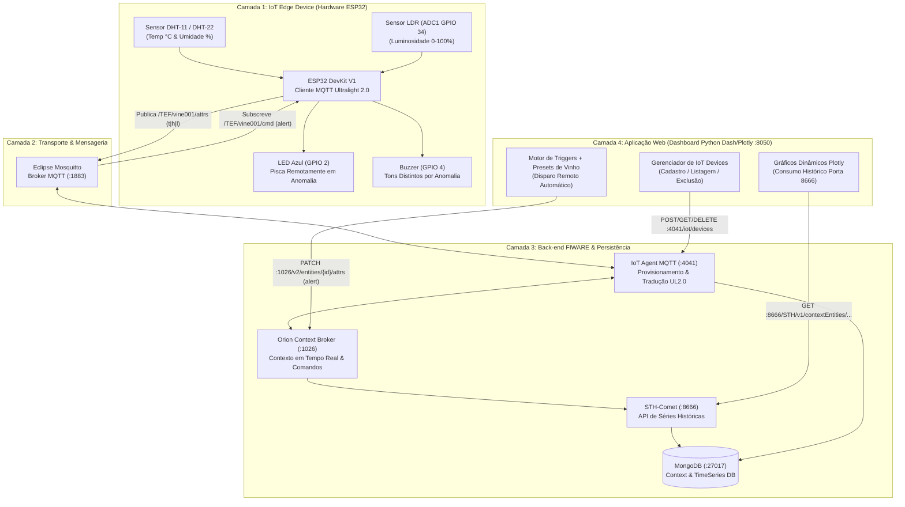
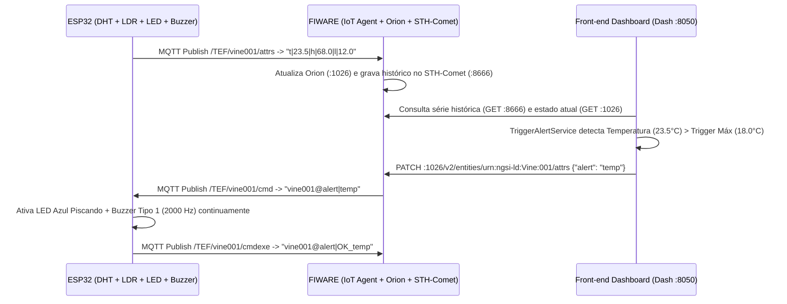

# 🍷 Monitoramento Global de Vinherias — IoT, FIWARE & Dashboard Dinâmico


-2EA44F?style=for-the-badge)

> **Check Point 5 — Edge Computing & Computer Systems**  
> Solução ponta a ponta de telemetria enológica em tempo real, análise de séries históricas via **API 8666 do STH-Comet**, provisionamento dinâmico de **IoT Devices** e acionamento remoto de alertas visuais (**LED Azul piscante**) e sonoros (**Buzzer multi-frequência por tipo de anomalia**) comandados diretamente pelo **Front-end**.

---

## 👥 Integrantes do Grupo

| Nome Completo | RM | Responsabilidade Principal |
| :--- | :---: | :--- |
| **[Inserir Nome do Integrante 1]** | `RM XXXXX` | Firmware ESP32 (`.ino`), Sensores DHT/LDR e Simulação Wokwi |
| **[Inserir Nome do Integrante 2]** | `RM XXXXX` | Infraestrutura FIWARE (Orion, IoT Agent MQTT e STH-Comet) |
| **[Inserir Nome do Integrante 3]** | `RM XXXXX` | Dashboard Dinâmico Web (Dash/Plotly) e Motor de Triggers |
| **[Inserir Nome do Integrante 4]** | `RM XXXXX` | Documentação Técnica, Testes TDD e Pitch Hands-on |

---

## 📖 1. Descrição Completa da Solução

A conservação de vinhos de alta gama exige controle rigoroso de **Temperatura**, **Umidade Relativa** e **Luminosidade**. Variações térmicas aceleram reações químicas indesejadas, baixa umidade resseca as rolhas permitindo oxidação, e a incidência luminosa degrada compostos fenólicos (*lightstrike*).

Nossa solução resolve esse desafio através de uma arquitetura distribuída em **4 camadas**:
1. **Sensores & Atuadores (ESP32)**: Coleta contínua de temperatura e umidade (**DHT-11** em bancada física / **DHT-22** no Wokwi) e luminosidade (**LDR** no `ADC1`), publicando via protocolo **Ultralight 2.0 sobre MQTT**.
2. **Back-end FIWARE**: O **IoT Agent MQTT (`:4041`)** traduz os pacotes para entidades NGSI-v2 no **Orion Context Broker (`:1026`)**, enquanto o **STH-Comet (`:8666`)** persiste as séries históricas no **MongoDB**.
3. **Dashboard Dinâmico Web (Python / Dash / Plotly)**: Permite cadastrar e remover IoT Devices em tempo real, visualizar gráficos dinâmicos históricos da API `8666` do STH-Comet e ajustar os **Triggers (Mín/Máx)** de cada grandeza.
4. **Acionamento Remoto Inteligente pelo Front-end**: Sempre que qualquer parâmetro ultrapassa os triggers definidos no dashboard, o Front-end envia automaticamente um comando remoto via FIWARE (`PATCH /v2/entities/{id}/attrs`) que faz o **LED Azul do ESP32 piscar ininterruptamente** e aciona o **Buzzer com uma assinatura sonora exclusiva para cada tipo de anomalia**, desligando-os assim que o valor retorna à faixa normal.

---

## 🏗️ 2. Arquitetura em Camadas



### Fluxo de Sequência do Alerta Remoto (Ativado pelo Front-end)



---

## 🔊 3. Matriz de Alertas Visuais e Sonoros por Tipo de Anomalia

Todas as vezes que um parâmetro sai da faixa de triggers configurada no Front-end, o dashboard envia o comando correspondente para o ESP32:

| Estado / Anomalia Detectada | Comando FIWARE | Comportamento do LED Azul (`GPIO 2`) | Assinatura Sonora do Buzzer (`GPIO 4`) |
| :--- | :---: | :--- | :--- |
| ✅ **Parâmetros Normais** | `alert\|normal` | **Desligado (`LOW`)** | Silenciado (`noTone`) |
| 🌡️ **Anomalia de Temperatura** | `alert\|temp` | **Piscando continuamente (400 ms)** | **Tipo 1**: Bips Agudos Rápidos (`2000 Hz` por `180 ms`) |
| 💧 **Anomalia de Umidade** | `alert\|hum` | **Piscando continuamente (400 ms)** | **Tipo 2**: Pulsos Graves Encorpados (`850 Hz` por `280 ms`) |
| ☀️ **Anomalia de Luminosidade** | `alert\|lum` | **Piscando continuamente (400 ms)** | **Tipo 3**: Sirene Alternada Dupla (`1200 Hz` / `1700 Hz`) |
| 🚨 **Anomalia Múltipla (2+ sensores)** | `alert\|multi` | **Piscando rápido (200 ms)** | **Tipo 4**: Escala Tripla de Emergência (`1000` → `1800` → `2500 Hz`) |

---

## 🏆 4. Diferenciais Implementados (10% da Nota)

1. **Telemetria Verídica em Tempo Real de 9 Vinícolas Reais do Mundo (Satélite & Estações Open-Meteo)**: Monitoramento ao vivo de Temperatura (`°C`), Umidade Relativa (`%`), Luminosidade Solar (`%` e `W/m²`) e Ponto de Orvalho (*Magnus-Tetens*) de **Vinícola Miolo (RS)**, **Villa Francioni (SC)**, **Vinícola Guaspari (SP)**, **Bodega Catena Zapata (Argentina)**, **Viña Concha y Toro (Chile)**, **Château Margaux (França)**, **Marchesi Antinori (Itália)**, **Quinta do Crasto (Portugal)** e **Opus One (EUA)**.
2. **Protótipo 3D Físico (`Corpo_Barril.STL` + `Tampa_Display_LCD16x2.STL`) + Telinha Verde LCD 16x2 (`66×26mm`)**: Integração visual e física do recorte retangular da tampa com display LCD 16x2 I2C (`SDA 21 / SCL 22`) e **3 LEDs (`Verde GPIO 5`, `Vermelho GPIO 18`, `Azul Remoto GPIO 2`) + Buzzer (`GPIO 4`)**.
3. **Presets Enológicos Inteligentes & Gráficos SCADA**: Seleção com 1 clique para **Vinho Tinto**, **Branco & Rosé**, **Espumante** e **Cave de Envelhecimento**, com gráficos Plotly contendo zona ideal sombreada, marcadores diamante em anomalias e linha de média.
4. **Integração de API Plug-and-Play Bidirecional (`Wokwi ↔ Site ↔ Supabase Cloud`)**: Qualquer pessoa que baixar a pasta e abrir o Wokwi tem comunicação em tempo real nos dois sentidos, sem precisar configurar `.env`, coberto por **13 testes automatizados (`pytest`)**.

---

## 📂 5. Estrutura Modular do Projeto

```text
├── INICIAR_PROJETO.bat                 # Inicializador de 1 clique (abre Site + Wokwi já sincronizados)
├── sketch.ino                          # Firmware ESP32 Zero-Libs (DHT22 + LDR + LCD 16x2 I2C + 3 LEDs + Buzzer)
├── diagram.json                        # Circuito Wokwi completo (ESP32 + LCD 16x2 Verde + 3 LEDs + Sensores)
├── supabase_schema.sql                 # Schema PostgreSQL otimizado (Índices B-Tree, RLS e View Analítica)
├── hardware/
│   ├── wokwi_dht22/                    # Projeto completo para o Simulador Wokwi (DHT-22 + LCD 16x2)
│   └── handson_dht11/                  # Firmware calibrado para o Barril Físico (DHT-11 + LCD 16x2)
├── dashboard/
│   ├── app.py                          # Entrypoint do servidor web Dash + API REST (Porta 8050)
│   ├── requirements.txt                # Dependências Python
│   ├── src/
│   │   ├── config/settings.py          # Configurações Plug-and-Play (MQTT, FIWARE, Supabase, Open-Meteo)
│   │   ├── models/iot_models.py        # Dataclasses tipadas (Triggers, Séries, Vinícolas Reais)
│   │   ├── repositories/               # Clientes MQTT Wokwi, Open-Meteo, Supabase, STH-Comet e Orion
│   │   ├── services/                   # Regras de negócio de Triggers, Alertas Remotos e Devices
│   │   └── ui/                         # Componentes visuais, Telinha Verde, Gráficos SCADA e Rotas API
│   └── tests/                          # 13 testes automatizados (Pytest)
└── docs/
    └── MANUAL_INSTALACAO_E_OPERACAO.md # Manual completo de montagem de Hardware e operação de Software
```

---

## 🚀 6. Links Rápidos e Execução Plug-and-Play (Para Avaliadores)

- 💻 **Repositório Oficial no GitHub**:
  - 👉 **[https://github.com/six01010101010101/checkpoint5-vinheria-fiware-esp32](https://github.com/six01010101010101/checkpoint5-vinheria-fiware-esp32)**
- 🌐 **Link Oficial da Simulação no Wokwi (ESP32 + Tela Verde LCD 16x2 + 3 LEDs + Buzzer + DHT22 + LDR)**:
  - 👉 **[https://wokwi.com/projects/478106752109243393](https://wokwi.com/projects/478106752109243393)**
- 🗄️ **Banco de Dados em Nuvem no Supabase (PostgreSQL — `Vinheria Agnello CP5`)**:
  - 👉 **API / Project URL**: `https://slqozouuqzxwmfswyroo.supabase.co` (`vine_devices`, `vine_trigger_configs`, `vine_telemetry`, `real_vineyards_status`, `v_vine_telemetry_summary`)
- 📘 **[Manual Completo de Instalação e Operação (Software + Hardware)](./docs/MANUAL_INSTALACAO_E_OPERACAO.md)**

### Como Executar ao Baixar a Pasta (Zero Configuração):
1. Dê um **duplo clique em `INICIAR_PROJETO.bat`** (ou execute os comandos abaixo) e dê **Play** no link do Wokwi (`https://wokwi.com/projects/478106752109243393`):
```bash
cd dashboard
pip install -r requirements.txt
python app.py
# Dashboard Ao Vivo: http://127.0.0.1:8050
# API Status JSON:   http://127.0.0.1:8050/api/v1/status
# API Vinícolas:     http://127.0.0.1:8050/api/v1/vineyards
```

