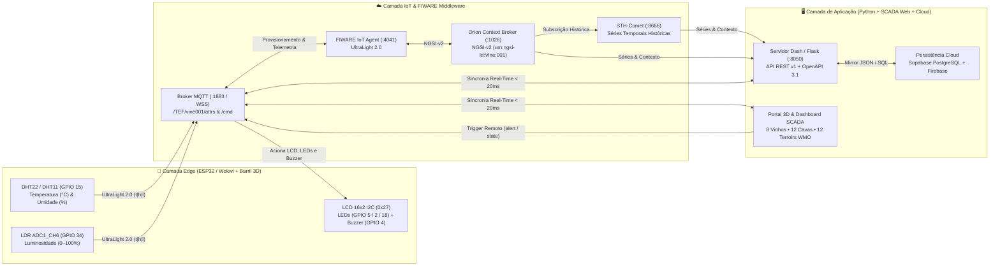
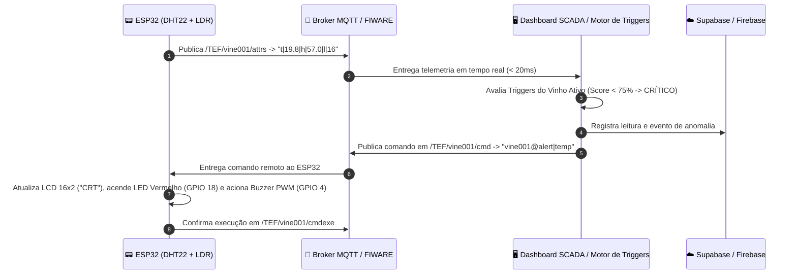

# 🍷 Vinheria Agnello — Check Point 5: Telemetria Enológica IoT, FIWARE & ESP32

<div align="center">


**Sistema Cyber-Físico de Monitoramento de Precisão para Cavas Subterrâneas, Estilos de Vinho e Terroirs Globais em Tempo Real**

[🚀 Simulador Wokwi (ESP32 Ao Vivo)](https://wokwi.com/projects/478106752109243393) •
[🌐 Deploy na Nuvem (Render)](https://checkpoint5-vinheria-fiware-esp32-1.onrender.com/) •
[💻 Repositório GitHub](https://github.com/six01010101010101/vinheria-fiware-esp32) •
[🏺 Portal Barril 3D (`index.html`)](./index.html) •
[📊 Dashboard SCADA (`dashboard.html`)](./dashboard.html) •
[⚡ API Status (`status`)](./api/v1/status/index.html) •
[📖 Manual de Operação](./docs/MANUAL_INSTALACAO_E_OPERACAO.md)

</div>

---

## 📑 Sumário Executivo

1. [Identificação Acadêmica e Requisitos Atendidos](#-1-identificação-acadêmica-e-requisitos-atendidos)
2. [Contextualização do Problema e Modelagem Enológica](#-2-contextualização-do-problema-e-modelagem-enológica)
3. [Design Físico: Barril 3D e Tampa com Display LCD 16x2](#-3-design-físico-barril-3d-e-tampa-com-display-lcd-16x2)
4. [Arquitetura Cyber-Física e Fluxo Bidirecional (`< 20ms`)](#️-4-arquitetura-cyber-física-e-fluxo-bidirecional--20ms)
5. [Hardware Embarcado (ESP32 DevKit V1) e Pinout Oficial](#-5-hardware-embarcado-esp32-devkit-v1-e-pinout-oficial)
6. [Matriz de Diagnóstico LED (3 Estados) e Alarmes Sonoros](#-6-matriz-de-diagnóstico-led-3-estados-e-alarmes-sonoros)
7. [Catálogo Enológico: 8 Estilos de Vinho, 15 Lotes e 15 Terroirs WMO](#-7-catálogo-enológico-8-estilos-de-vinho-15-lotes-e-15-terroirs-wmo)
8. [API REST v1, Persistência Cloud e Protocolo MQTT UltraLight 2.0](#-8-api-rest-v1-persistência-cloud-e-protocolo-mqtt-ultralight-20)
9. [Estrutura Modular do Repositório](#️-9-estrutura-modular-do-repositório)
10. [Como Executar, Simular e Testar o Projeto (Passo a Passo)](#-10-como-executar-simular-e-testar-o-projeto-passo-a-passo)

---

## 👩‍🎓 1. Identificação Acadêmica e Requisitos Atendidos

| Aluno(a) | GitHub | Instituição / Disciplina | Escopo Desenvolvido |
| :--- | :---: | :--- | :--- |
| **Ken Kobayashi** | [`@six01010101010101`](https://github.com/six01010101010101) | **FIAP** — *Edge Computing, IoT & Sistemas Distribuídos* | Arquitetura Full-Stack, Firmware C++ ESP32 ([`sketch.ino`](./sketch.ino)), Sincronismo Supabase/Telegram, Modelagem 3D, Servidor Local e SCADA |
| **Nicolly Vilela** | [`@ninixzzs`](https://github.com/ninixzzs) | **FIAP** — *Edge Computing, IoT & Sistemas Distribuídos* | Arquitetura IoT, Testes Automatizados TDD (31/31), Integração Mecânica em Barril 3D, Portal Barril 3D e APIs REST v1 |

### Checklist de Entregáveis (Critérios de Avaliação CP5)
- [x] **Hardware ESP32 + Sensores + Atuadores (Wokwi & Hands-On)**: Leitura contínua de Temperatura e Umidade (**DHT22/DHT11** no `GPIO 15`), Luminosidade (**LDR** no `GPIO 34` via `ADC1`), visor **LCD 16x2 I2C (`0x27`)**, **3 LEDs de diagnóstico** (`GPIO 5`, `GPIO 2`, `GPIO 18`) e **Buzzer PWM** (`GPIO 4`).
- [x] **Integração FIWARE & MQTT (UltraLight 2.0)**: Publicação periódica no tópico `/TEF/vine001/attrs` (`t|...|h|...|l|...`) e subscrição de comandos remotos em `/TEF/vine001/cmd`, com provisionamento automático no **IoT Agent (`:4041`)**, **Orion Context Broker (`:1026`)** e **STH-Comet (`:8666`)**.
- [x] **Dashboard Dinâmico & Séries Temporais**: Gráficos em tempo real de Temperatura (`°C`), Umidade (`%`) e Luminosidade (`%`), com seleção histórica (`lastN`), suporte a temas **Claro**, **Escuro** e **Sistema**, e renderização vetorial SVG de latência zero.
- [x] **Sistema de Triggers e Alerta Remoto Bidirecional**: Definição manual ou automática de limites mínimos e máximos; quando violados, o Dashboard dispara um comando imediato que aciona os LEDs e o Buzzer do ESP32 com padrões sonoros distintos por anomalia.
- [x] **Diferencial Enológico & Cloud-Native**: Presets inteligentes para **8 estilos de vinho**, auditoria de **15 lotes de cavas subterrâneas**, telemetria meteorológica via satélite de **15 vinícolas globais (Open-Meteo WMO: França, Itália, Brasil, EUA, Canadá, Austrália, Japão, etc.)**, espelhamento em nuvem (**Supabase PostgreSQL 17 + Firebase**), bot **Telegram @vinheria_agnello_bot (Grupo Admin Vinheira a cada 5 min)** e **31 testes unitários/integração automatizados (`pytest`)**.

---

## 🎯 2. Contextualização do Problema e Modelagem Enológica

A **Vinheria Agnello** armazena rótulos de guarda cuja integridade físico-química depende do controle rigoroso de três variáveis ambientais:

1. **Temperatura (`°C`)**: Temperaturas elevadas (`> 18°C`) aceleram reações de oxidação fenólica e evaporação hidroalcoólica; temperaturas muito baixas provocam precipitação tartárica e endurecimento da cortiça.
2. **Umidade Relativa (`% UR`)**: Baixa umidade (`< 60%`) resseca a rolha de cortiça, permitindo micro-oxigenação excessiva e acetificação do vinho; umidade excessiva (`> 80%`) favorece proliferação fúngica e degradação de rótulos.
3. **Luminosidade (`% / Lux`)**: A radiação visível e ultravioleta fotoativa a riboflavina do vinho, oxidando aminoácidos sulfurados e gerando o defeito organoléptico conhecido como *gout de lumière* ("gosto de luz"), crítico especialmente em brancos, rosés e espumantes.

### 📐 Equações Implementadas no Motor Analítico

#### 1. Ponto de Orvalho Psicrométrico (Fórmula de Magnus-Tetens)
Calculado continuamente para prever risco de condensação superficial nas garrafas:

$$\gamma(T, RH) = \frac{17.27 \cdot T}{237.7 + T} + \ln\left(\frac{RH}{100}\right), \qquad T_d = \frac{237.7 \cdot \gamma(T, RH)}{17.27 - \gamma(T, RH)}$$

#### 2. Índice de Saúde e Preservação Enológica ($\text{Score} \in [15\%, 100\%]$)
Avalia em tempo real a aderência das leituras $(T, H, L)$ em relação à janela ideal $([T_{\min}, T_{\max}], [H_{\min}, H_{\max}], L_{\max})$ do estilo de vinho selecionado:

$$\text{Penalidade} = 7.5 \cdot \Delta T_{\text{fora}} + 1.6 \cdot \Delta H_{\text{fora}} + 1.3 \cdot \Delta L_{\text{fora}}$$

- Quando $\text{Penalidade} = 0$ (dentro da faixa ideal), o score varia entre **$95\%$ e $100\%$** conforme a proximidade ao centro ótimo $(T_{\text{mid}}, H_{\text{mid}})$.
- Quando há violação de limites ($\text{Penalidade} > 0$), o score decai proporcionalmente, acionando o estado **PADRÃO ($75\%–94\%$)** ou **CRÍTICO ($< 75\%$)** com disparo imediato do alarme acústico e visual no ESP32.

---

## 🏺 3. Design Físico: Barril 3D e Tampa com Display LCD 16x2

O projeto integra a eletrônica embarcada ao encapsulamento físico de um **Barril Enológico 3D** com visor **LCD 16x2 I2C (`HD44780`)** embutido na tampa superior, permitindo inspeção presencial na adega e espelhamento digital idêntico no Portal Web ([`index.html`](./index.html)):

<div align="center">
  
  &nbsp;&nbsp;&nbsp;&nbsp;
  
  <br/>
  <sub><b>Figura 1:</b> Modelagem do Corpo do Barril 3D (esquerda) e Tampa Superior com recorte para Display LCD 16x2 I2C e LEDs de Estado (direita).</sub>
</div>

---

## 🏗️ 4. Arquitetura Cyber-Física e Fluxo Bidirecional (`< 20ms`)



### Sequência de Disparo de Triggers e Atuação Remota



---

## 🔌 5. Hardware Embarcado (ESP32 DevKit V1) e Pinout Oficial

O firmware principal ([`sketch.ino`](./sketch.ino)) implementa leitura digital single-bus do **DHT22** com validação de *checksum* de 40 bits e filtro *anti-spike*, conversão analógica-digital em 12 bits (`0–4095`) do **LDR**, driver nativo I2C a `400 kHz` para o **LCD 16x2 (`0x27`)** com caracteres customizados em CGRAM e cliente **MQTT TCP (`:1883`)**.

| Componente Físico / Simulado | Pino do Componente | Pino no ESP32 | Barramento / Canal | Função Técnica no Firmware |
| :--- | :---: | :---: | :---: | :--- |
| **Sensor DHT22 / DHT11** | `SDA` / `DATA` | **`GPIO 15`** (`D15`) | Digital Single-Bus | Medição de Temperatura (`-40°C a +80°C`) e Umidade (`0–100%`) |
| **Fotoresistor LDR** | `AO` (Analógico) | **`GPIO 34`** (`D34`) | `ADC1_CH6` (12-bit) | Leitura de luminosidade sem conflito com o rádio Wi-Fi (`ADC1`) |
| **Display LCD 16x2 Verde** | `SDA` / `SCL` | **`GPIO 21` / `22`** | I2C (`0x27` @ `400 kHz`) | Exibição local de `T`, `U`, `L`, estilo de vinho e saúde (`%`) |
| **LED Verde (Estado Ideal)** | Anodo (`+`) | **`GPIO 5`** (`D5`) | Saída Digital (`GPIO`) | Acesso contínuo quando a adega opera na faixa Ideal (`95%–100%`) |
| **LED Amarelo (Padrão / Atenção)** | Anodo (`+`) | **`GPIO 2`** (`D2`) | Saída Digital (`GPIO`) | Indicador de estado Padrão/Atenção (`75%–94%`) e alerta visual |
| **LED Vermelho (Crítico)** | Anodo (`+`) | **`GPIO 18`** (`D18`) | Saída Digital (`GPIO`) | Indicador luminoso de violação crítica de Triggers (`< 75%`) |
| **Buzzer Piezoelétrico** | Positivo (`+` / `S`) | **`GPIO 4`** (`D4`) | Saída PWM (`tone`) | Alarme acústico multi-frequência por tipo de anomalia |

> [!IMPORTANT]
> **Decisão de Engenharia (`GPIO 34` — `ADC1_CH6`):** No ESP32, os canais do conversor `ADC2` sofrem bloqueio de leitura enquanto o subsistema Wi-Fi está transmitindo pacotes TCP/MQTT. O uso do `GPIO 34` (`ADC1`) garante leituras de luminosidade 100% estáveis durante a conexão contínua com o broker.

---

## 🚨 6. Matriz de Diagnóstico LED (3 Estados) e Alarmes Sonoros

### 6.1 Estados Operacionais de Saúde Enológica

| Estado Operacional | Faixa de Saúde | LED Ativo no ESP32 | Tag no LCD 16x2 | Comportamento no Hardware e no Dashboard SCADA |
| :--- | :---: | :---: | :---: | :--- |
| **🟢 IDEAL** | **`95% a 100%`** | **LED Verde (`GPIO 5`)** | `1UP: 95–100%` | Condições perfeitas de guarda; Buzzer silenciado (`0 Hz`) e selo verde. |
| **🟡 PADRÃO / ATENÇÃO** | **`75% a 94%`** | **LED Amarelo (`GPIO 2`)** | `PAD: 75–94%` | Leve desvio controlado; operação de adega em atenção sem risco imediato. |
| **🔴 CRÍTICO** | **`< 75%`** | **LED Vermelho (`GPIO 18`)** | `CRT: <75%` | Violação de limite! Acende LED Vermelho, pisca alerta e dispara o Buzzer. |

### 6.2 Padrões Acústicos do Buzzer (`GPIO 4`) por Comando de Trigger

Quando qualquer variável ultrapassa os limites configurados nos **Triggers**, o sistema envia o comando remoto correspondente ao ESP32:

| Comando MQTT (`/cmd`) | Tipo de Anomalia Detectada | Padrão Acústico no Buzzer (`GPIO 4`) | Sinalização Visual |
| :--- | :--- | :--- | :--- |
| `vine001@alert\|normal` | Parâmetros Normalizados | **Silenciado (`0 Hz`)** | LED Verde ativo (`GPIO 5`) |
| `vine001@alert\|temp` | Violação de **Temperatura** (`°C`) | **Alerta Tipo 1:** Bips agudos rápidos (`2000 Hz`) | LED Vermelho/Azul piscando |
| `vine001@alert\|hum` | Violação de **Umidade** (`% UR`) | **Alerta Tipo 2:** Pulsos graves duplos (`850 Hz`) | LED Vermelho/Azul piscando |
| `vine001@alert\|lum` | Violação de **Luminosidade** (`%`) | **Alerta Tipo 3:** Sirene alternada (`1200 Hz / 1700 Hz`) | LED Vermelho/Azul piscando |
| `vine001@alert\|multi` | **Anomalia Múltipla Crítica** | **Alerta Tipo 4:** Escala tripla de emergência (`1000 / 1800 / 2500 Hz`) | Piscagem rápida de emergência |

---

## 🍾 7. Catálogo Enológico: 8 Estilos de Vinho, 12 Lotes e 12 Terroirs WMO

### 7.1 Os 8 Presets de Estilo de Vinho (Calibração Instantânea de Triggers)

Ao selecionar qualquer estilo no Dashboard ou pela barra de busca, os **Triggers** de Temperatura, Umidade e Luminosidade são recalibrados automaticamente e transmitidos ao visor LCD 16x2 do ESP32:

| Código | Estilo de Vinho | Janela Térmica Ideal | Umidade Ideal | Luz Máxima | Lote de Cava Padrão | Rótulo de Referência |
| :---: | :--- | :---: | :---: | :---: | :---: | :--- |
| `tinto` | **🍷 Vinho Tinto** | `14.0°C – 18.0°C` | `60% – 75%` | `≤ 25%` | `LOTE-FR-MARGAUX-01` | *Château Margaux Premier Grand Cru 2015* (🇫🇷) |
| `branco` | **🥂 Vinho Branco** | `8.0°C – 12.0°C` | `60% – 75%` | `≤ 15%` | `LOTE-FR-BLANC-02` | *Château Margaux Pavillon Blanc 2020* (🇮🇹/🇫🇷) |
| `rose` | **🌸 Vinho Rosé** | `10.0°C – 13.0°C` | `60% – 75%` | `≤ 12%` | `LOTE-FR-ROSE-03` | *Domaine Ott Château de Selle Rosé 2022* (🇨🇱/🇫🇷) |
| `espumante` | **🍾 Espumante Brut** | `6.0°C – 9.0°C` | `65% – 80%` | `≤ 10%` | `LOTE-RU-ABRAU-04` | *Abrau-Durso Imperial Brut Vintage 2018* (🇷🇺) |
| `pinot` | **🍒 Pinot Noir** | `12.0°C – 15.0°C` | `65% – 75%` | `≤ 15%` | `LOTE-FR-DRC-05` | *Domaine Romanée-Conti La Tâche 2018* (🇫🇷) |
| `porto` | **🏺 Vinho do Porto** | `15.0°C – 18.0°C` | `65% – 75%` | `≤ 20%` | `LOTE-PT-PORTO-06` | *Taylor's & Quinta do Crasto Vintage Port 2016* (🇵🇹) |
| `sobremesa` | **🍯 Colheita Tardia** | `9.0°C – 12.0°C` | `65% – 78%` | `≤ 12%` | `LOTE-DE-PRUM-07` | *Château d'Yquem Sauternes 2019* (🇩🇪/🇫🇷) |
| `laranja` | **🍊 Vinho Laranja** | `11.0°C – 14.0°C` | `60% – 72%` | `≤ 15%` | `LOTE-IT-GRAVNER-08` | *Josko Gravner Ribolla Gialla Ânfora 2017* (🇪🇸/🇮🇹) |

> Além dos 8 lotes acima, a adega monitora os lotes `LOTE-ES-VEGA-09` (*Vega Sicilia Único 2014*), `LOTE-NZ-CLOUDY-10` (*Cloudy Bay Te Koko 2021*), `LOTE-BR-MIOLO-11` (*Miolo Cuvée Giuseppe Rosé 2022*), `LOTE-AR-CATENA-12` (*Nicolás Catena Brut Nature 2018*), `LOTE-CA-OKANAGAN-13` (*Mission Hill Okanagan Reserve 2021*), `LOTE-AU-BAROSSA-14` (*Penfolds Magill Grange Shiraz 2017*) e `LOTE-JP-KOSHU-15` (*Grace Wine Koshu Hishiyama 2022*), totalizando **15 Cavas Subterrâneas** auditadas em tempo real.

### 7.2 As 15 Estações Meteorológicas Satelitais (Open-Meteo WMO)

O módulo [`satellite_terroirs.js`](./dashboard/assets/satellite_terroirs.js) e o daemon [`telegram_live_service.js`](./dashboard/src/services/telegram_live_service.js) consultam dados climáticos reais das regiões produtoras via API **Open-Meteo WMO**:

| ID Terroir | Vinícola / Terroir | Região & País | Coordenadas (`Lat, Lon`) |
| :---: | :--- | :--- | :---: |
| `fr_margaux` | **Château Margaux** | Bordeaux, França 🇫🇷 | `45.0444, -0.6686` |
| `it_antinori` | **Marchesi Antinori** | Toscana, Itália 🇮🇹 | `43.6158, 11.2136` |
| `cl_concha` | **Concha y Toro** | Vale do Maipo, Chile 🇨🇱 | `-33.6433, -70.5789` |
| `ru_abrau` | **Abrau-Durso** | Mar Negro / Krasnodar, Rússia 🇷🇺 | `44.7000, 37.6000` |
| `pt_crasto` | **Quinta do Crasto** | Vale do Douro, Portugal 🇵🇹 | `41.1681, -7.6308` |
| `us_opus` | **Opus One Winery** | Napa Valley, EUA 🇺🇸 | `38.4367, -122.4017` |
| `de_prum` | **Joh. Jos. Prüm** | Vale do Mosel, Alemanha 🇩🇪 | `49.9189, 7.0394` |
| `es_vega` | **Vega Sicilia** | Ribera del Duero, Espanha 🇪🇸 | `41.6322, -4.2981` |
| `nz_cloudy` | **Cloudy Bay** | Marlborough, Nova Zelândia 🇳🇿 | `-41.4914, 173.9619` |
| `za_kanonkop` | **Kanonkop Estate** | Stellenbosch, África do Sul 🇿🇦 | `-33.8569, 18.8669` |
| `br_miolo` | **Vinícola Miolo** | Vale dos Vinhedos (RS), Brasil 🇧🇷 | `-29.1864, -51.5567` |
| `ar_catena` | **Catena Zapata** | Gualtallary, Mendoza, Argentina 🇦🇷 | `-33.1667, -68.9167` |
| `ca_okanagan` | **Mission Hill Estate** | Okanagan Valley, Canadá 🇨🇦 | `49.8880, -119.4960` |
| `au_barossa` | **Penfolds Magill** | Barossa Valley, Austrália 🇦🇺 | `-34.4820, 138.9890` |
| `jp_koshu` | **Grace Wine (Fuji)** | Koshu, Yamanashi, Japão 🇯🇵 | `35.7000, 138.7300` |

---

## 📡 8. API REST v1, Persistência Cloud e Protocolo MQTT UltraLight 2.0

A aplicação expõe uma **API REST v1** documentada sob o padrão **OpenAPI 3.1.0**, com suporte a negociação de conteúdo (`Accept: application/json` ou interface visual HTML interativa):

| Método | Endpoint / Tópico | Formato | Descrição Técnica |
| :---: | :--- | :---: | :--- |
| `GET` | [`/api/v1/status`](./api/v1/status/index.html) | `HTML / JSON` | Diagnóstico de saúde da adega, estado do broker MQTT, sensores, atuadores e alertas ativos |
| `GET` | [`/api/v1/lots`](./api/v1/lots/index.html) | `HTML / JSON` | Catálogo auditável dos **15 Lotes de Cava**, safras, barricas, temperatura, umidade e score (`%`) |
| `GET` | `/api/v1/vineyards` | `HTML / JSON` | Telemetria em tempo real dos **15 Terroirs Globais** e do hardware **ESP32 Wokwi** |
| `GET` | `/api/v1/telemetry/history` | `HTML / JSON` | Séries históricas de Temperatura, Umidade e Luminosidade (STH-Comet / Buffer / Supabase) |
| `GET` | [`/api/v1/cloud/firebase`](./api/v1/cloud/firebase/index.html) | `HTML / JSON` | Espelho JSON completo da adega sincronizado com **Supabase PostgreSQL 17** e **Firebase** |
| `POST` | `/api/v1/telegram/alert` | `JSON` | Disparo instantâneo de alerta sonoro e enológico para o grupo Telegram Admin Vinheira |
| `POST` | `/api/v1/telegram/broadcast` | `JSON` | Disparo manual/periódico (5 min) do boletim consolidado da rede de cavas e terroirs |
| `MQTT` | `/TEF/vine001/attrs` | `UltraLight 2.0` | Tópico de publicação de telemetria pelo ESP32 (ex.: `t\|15.8\|h\|68.0\|l\|9`) |
| `MQTT` | `/TEF/vine001/cmd` | `UltraLight 2.0` | Tópico de comandos remotos recebidos pelo ESP32 (ex.: `vine001@diag\|critico\|...` ou `vine001@sync\|...`) |

---

## 🗂️ 9. Estrutura Modular do Repositório

```text
vinheria-fiware-esp32/
├── index.html                             # Portal Sommelier & Visualização do Barril 3D com LCD interativo
├── dashboard.html                         # Aplicação Web SCADA Sommelier completa em tempo real
├── sketch.ino                             # Firmware C++ principal do ESP32 (Wokwi, LCD I2C 0x27, DHT22, LDR e MQTT)
├── diagram.json                           # Circuito elétrico completo do ESP32 no simulador Wokwi
├── wokwi.toml                             # Configuração de build e simulação Wokwi CLI
├── libraries.txt                          # Bibliotecas Arduino utilizadas pelo firmware
├── integrantes.txt                        # Identificação oficial da aluna Nicolly Vilela e links do projeto
├── INICIAR_PROJETO.bat                    # Inicialização Plug-and-Play (abre Dashboard, Wokwi e servidor :8050)
├── requirements.txt                       # Dependências Python na raiz para deploy em nuvem (Render / Gunicorn)
├── Procfile                               # Definição de processo WSGI para produção
├── render.yaml                            # Infraestrutura como Código (IaC) para deploy contínuo no Render
├── supabase_schema.sql                    # Schema PostgreSQL das tabelas de telemetria, lotes e alertas
├── api/v1/                                # Páginas estáticas espelhadas e especificação OpenAPI 3.1 (openapi.json)
├── dashboard/
│   ├── app.py                             # Servidor principal Python (Dash + Flask REST API v1 na porta 8050)
│   ├── requirements.txt                   # Dependências do servidor e da suíte de testes
│   ├── assets/                            # Módulos JS (wine_catalog, cellar_lots, satellite_terroirs, scada_mqtt) e CSS
│   ├── src/
│   │   ├── config/settings.py             # Constantes FIWARE, portas, tópicos MQTT e presets enológicos
│   │   ├── models/                        # Modelos de domínio tipados (IoT, Lotes de Cava e Vinhos)
│   │   ├── repositories/                  # Integrações FIWARE IoT, STH-Comet, MQTT Wokwi, Open-Meteo, Supabase e Firebase
│   │   ├── services/                      # Regras de negócio (Saúde da Cava, Triggers de Alerta, Device Manager)
│   │   └── ui/                            # Componentes visuais Dash, Callbacks reativos e Rotas da API REST v1
│   └── tests/                             # Suíte TDD com 31 testes automatizados (Pytest)
├── docs/
│   └── MANUAL_INSTALACAO_E_OPERACAO.md    # Manual detalhado de montagem física (Hands-On) e operação FIWARE
└── hardware/
    ├── handson_dht11/                     # Firmware para bancada física em laboratório (ESP32 + DHT11)
    └── wokwi_dht22/                       # Firmware e diagrama dedicados para validação no simulador Wokwi
```

---

## 🚀 10. Como Executar, Simular e Testar o Projeto (Passo a Passo)

### Opção 1: Execução Instantânea no Navegador (Zero Configuração)
- Abra diretamente o arquivo **[`index.html`](./index.html)** (Portal do Barril 3D) ou **[`dashboard.html`](./dashboard.html)** (Dashboard SCADA Completo) em qualquer navegador moderno, ou acesse o deploy em nuvem:
  👉 **[https://checkpoint5-vinheria-fiware-esp32-1.onrender.com/](https://checkpoint5-vinheria-fiware-esp32-1.onrender.com/)**

### Opção 2: Inicialização Completa com 1 Clique no Windows (`Plug-and-Play`)
- Dê duplo clique em **[`INICIAR_PROJETO.bat`](./INICIAR_PROJETO.bat)**.
- O script instala automaticamente as dependências necessárias, abre o Dashboard local (`http://127.0.0.1:8050`), abre o simulador Wokwi e inicia o servidor Python em tempo real.

### Opção 3: Inicialização Manual via Terminal (Python 3.10+)
```bash
# 1. Instale as dependências do projeto
pip install -r dashboard/requirements.txt

# 2. Inicie o servidor Back-End + Dashboard na porta 8050
python dashboard/app.py
```
Acesse no navegador: **`http://127.0.0.1:8050`**

### 🧪 Executando a Suíte de Testes Automatizados (TDD — 31/31 Testes)
O projeto conta com **31 testes automatizados** cobrindo modelos, repositórios FIWARE/STH-Comet/Firebase, motor de Triggers, serviço de lotes e endpoints da API REST v1:
```bash
pytest dashboard/tests/ -v
```

### 📟 Simulando o Hardware ESP32 no Wokwi em Tempo Real
1. Acesse o projeto oficial no Wokwi: **[https://wokwi.com/projects/478106752109243393](https://wokwi.com/projects/478106752109243393)**.
2. Pressione o botão **Play (Start Simulation)**.
3. No **Dashboard Web**, clique em diferentes estilos de vinho (*Tinto*, *Branco*, *Rosé*, *Espumante*, etc.) ou altere a temperatura/umidade no sensor **DHT22** e a luz no **LDR** dentro do Wokwi:
   - O visor **LCD 16x2 verde**, os **3 LEDs de diagnóstico** e o **Buzzer piezoelétrico** respondem bidirecionalmente em menos de `20ms` via MQTT.

---

<div align="center">
  <sub>Desenvolvido por <b>Ken Kobayashi</b> (<a href="https://github.com/six01010101010101">@six01010101010101</a>) e <b>Nicolly Vilela</b> (<a href="https://github.com/ninixzzs">@ninixzzs</a>) — FIAP • Check Point 5 • Engenharia de Software (IoT, FIWARE & ESP32)</sub>
</div>
